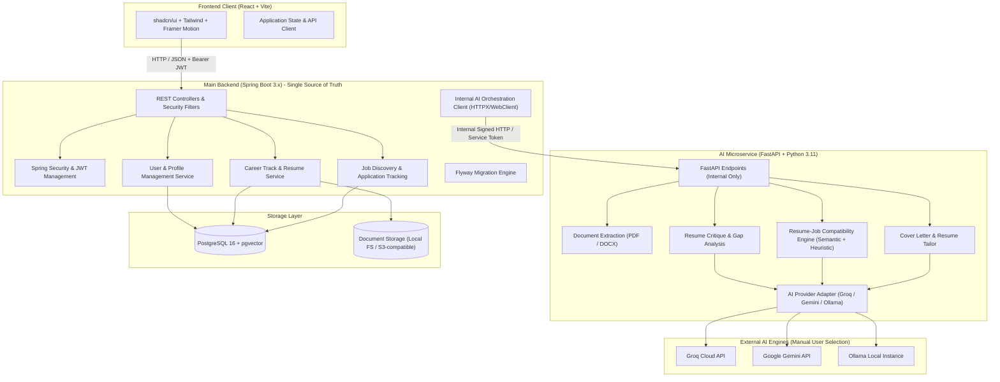

# AGENTS.md — Developer & AI Agent Operating Guide

## Project: JobAchiever AI
**Version:** 1.0.0-SNAPSHOT  
**Repository:** [https://github.com/abhirambuilds/jobachiever-ai](https://github.com/abhirambuilds/jobachiever-ai)  
**Primary Roles:** Senior Software Architect + Senior Full-Stack Developer  

---

## 1. Project Overview

**JobAchiever AI** is a multi-user, AI-powered Career Operating System designed to guide and empower job seekers—from college students and freshers to experienced professionals and career switchers—through every phase of the modern hiring lifecycle.

The platform provides an integrated suite of capabilities:
1. **Comprehensive Profile Building:** Master career profile capturing skills, experiences, projects, education, certifications, and achievements.
2. **Resume Upload & Multi-Format Parsing:** Intelligent ingestion of PDF, DOCX, and text resumes with structural extraction.
3. **Weakness & Opportunity Analysis:** Detailed, actionable critiques evaluating formatting, phrasing, missing impact metrics, and keyword coverage.
4. **Multiple Career Tracks:** Ability to manage distinct career personas (e.g., "Full-Stack Engineer", "Engineering Manager", "Solutions Architect") under one unified account.
5. **Tailored Resume Generation:** Generation of targeted, ATS-friendly resumes customized to specific role descriptions without manual rework.
6. **Job Description (JD) Ingestion & Decomposition:** Deep structural parsing of job listings to extract required qualifications, bonus skills, role responsibilities, and culture signals.
7. **Explainable Compatibility Scoring:** Transparent, granular match scores breaking down skills alignment, experience relevance, seniority fit, and actionable gap analysis.
8. **Job Opportunity Discovery & Aggregation:** Centralized discovery and tracking of relevant openings matching user career tracks.
9. **Application Tracking & Kanban Pipeline:** Full lifecycle tracking from wishlisted to applied, interview stages, offers, and decisions.
10. **Targeted Cover Letter Generation:** Context-aware, personalized cover letters highlighting role-relevant user achievements.
11. **Professional Portfolio Builder:** Clean, shareable web portfolio profiles showcasing projects, verified credentials, and career milestones.
12. **Interview Preparation Suite:** AI-powered mock interviews, behavioral question practice (STAR method), technical deep-dives, and role-specific question banks.
13. **AI Career Strategist & Advisory:** Personalized career roadmaps, skill acquisition suggestions, and market alignment recommendations.

---

## 2. Product Vision & Core Principles

The overarching vision of JobAchiever AI is to turn the chaotic, stressful process of career advancement into a structured, data-driven, and empowering journey.

### Non-Negotiable Core Product Principles:
- **Zero Fabrication & Absolute Truthfulness:** The platform must **never** fabricate qualifications, technical skills, years of experience, or career achievements. If a user lacks a qualification requested by a job description, the AI must highlight the gap honestly and advise on how to bridge or compensate for it, never invent claims.
- **Strict Human-in-the-Loop Verification:** AI-extracted information from uploaded resumes or job listings is strictly marked as `UNVERIFIED` until the user inspects, edits, and confirms it. Only confirmed data enters the verified profile graph.
- **User Approval on Consequential Actions:** Any action that alters external state, submits applications, updates public portfolio links, or replaces saved master resumes requires explicit user review and confirmation.
- **Isolated & Protected Multi-User Data:** Every user’s data, documents, match analyses, and conversation logs must be cryptographically and architecturally isolated. Multi-tenancy leaks are strictly zero-tolerance.
- **Premium Commercial SaaS Aesthetics:** The user interface must reflect the finish, responsiveness, typography, and elegance of top-tier commercial products (such as Linear, Vercel, Stripe). Clunky demo-ware interfaces are prohibited.
- **Real Functionality Over Demonstrations:** Every feature, parser, matching algorithm, and service must perform real computation and real database persistence. No mock stubs or superficial hard-coded placeholders disguised as working software.
- **Extensible & Modular Architecture:** Clear separation of concerns between client presentation, core business orchestration, and AI reasoning pipelines to allow independent scaling and technology evolution.

---

## 3. Target Users

1. **College Students & Interns:** Seeking first internships or entry-level positions; need assistance translating coursework, capstones, and extracurriculars into commercially recognized resume impact statements.
2. **Freshers & Early Career Professionals (0–3 Years):** Navigating competitive entry markets; require rigorous ATS optimization, resume weakness diagnosis, and interview readiness.
3. **Mid-to-Senior & Specialized Professionals (3–15+ Years):** Juggling multiple career tracks (e.g., individual contributor vs. management tracks); require precision keyword alignment, executive summary crafting, and pipeline management.
4. **Career Switchers:** Pivoting between industries or domains (e.g., QA to Dev, Finance to Data Science); need deep transferable skills analysis and gap mitigation.

---

## 4. Technology Stack

| Layer | Technologies & Libraries |
| :--- | :--- |
| **Frontend** | React 18+, JavaScript (ESNext), Vite, Tailwind CSS, shadcn/ui (Radix UI primitives), Framer Motion, Lucide Icons, Axios |
| **Main Backend** | Java 21 LTS, Spring Boot 3.x, Spring Security 6.x, Spring Data JPA, JJWT, Flyway, Lombok, MapStruct |
| **AI Service** | Python 3.11+, FastAPI, Pydantic v2, HTTPX, PyPDF, pdfplumber, python-docx, Uvicorn |
| **Database** | PostgreSQL 16+ with `pgvector` extension for semantic embeddings and similarity search |
| **Database Migrations** | Flyway (managed via Spring Boot migration engine) |
| **Containerization** | Docker, Docker Compose |
| **Supported AI Providers** | **Groq** (high-throughput low-latency inference), **Google Gemini** (Gemini 1.5/2.0 Flash & Pro), **Ollama** (local, privacy-centric open models) |

> **Note on PostgreSQL:** PostgreSQL Server is not yet installed in the current local setup. No attempt should be made to connect to a live database or execute DDL/DML migrations until the database infrastructure is provisioned in a subsequent milestone.

---

## 5. System Architecture

JobAchiever AI adopts a cleanly separated, decoupled two-tier backend architecture:



### Critical Architectural Rule: Primary Backend as Source of Truth
- **Spring Boot** is the sole owner and authoritative source of truth for:
  - User identity, registration, password hashing, and token issuance.
  - Profile state, career tracks, verified skills, and work history.
  - Job application records, statuses, and notes.
  - Document metadata, ownership validation, and storage dispatch.
- **FastAPI** is an internal, stateless AI processing engine.
  - FastAPI **never** manages user accounts, user credentials, or independent user databases.
  - FastAPI receives extraction, matching, and generation requests dispatched by Spring Boot (or authenticated via trusted service validation).
  - FastAPI transforms documents and prompts, invokes the user's chosen AI provider, structures the output, and returns the response back to Spring Boot.

---

## 6. Frontend Conventions

- **Directory Organization:**
  - `src/components/ui/`: Primitive UI components installed via shadcn/ui.
  - `src/components/common/`: Shared layout, headers, navigation bars, modals, empty states, and feedback banners.
  - `src/features/`: Domain-driven feature directories (e.g., `auth/`, `profile/`, `resumes/`, `jobs/`, `interviews/`, `career-tracks/`). Each feature folder contains its dedicated components, hooks, and API service functions.
  - `src/services/`: Base HTTP clients, token refresh interceptors, and global API endpoints.
  - `src/hooks/`: Reusable custom hooks (e.g., `useAuth`, `useDebounce`, `useTheme`).
  - `src/context/`: Global contexts (e.g., `AuthContext`, `ThemeContext`).
- **Styling & Design System:**
  - Standardized Tailwind color tokens (`bg-background`, `text-foreground`, `border-border`, `bg-card`).
  - Dark mode first-class support via class-based theme toggling.
  - Visual hierarchy: crisp typography, subtle border borders (`border-border/60`), muted labels for secondary metadata (`text-muted-foreground`), and high-clarity status badges.
- **Motion & Interactions:**
  - Use `framer-motion` for page transitions, tab switches, expandable accordions, and subtle list entry animations.
  - Maintain snappy UI: animation durations should not exceed 200–300ms. Respect `prefers-reduced-motion`.
- **Form Handling:**
  - Comprehensive form validation with explicit field-level error messages.
  - Loading states on buttons with spinner icons and disabled states to prevent double submission.

---

## 7. Backend Conventions (Spring Boot)

- **Package Architecture:** Root package `com.jobachiever`.
  - `com.jobachiever.config`: Security, CORS, WebClient, Async, Flyway configurations.
  - `com.jobachiever.security`: JWT filter, TokenProvider, UserPrincipal, CustomUserDetailsService.
  - `com.jobachiever.modules.{domain}`: Modular architecture per business domain (e.g., `user`, `profile`, `resume`, `job`, `application`, `ai`):
    - `controller/`: REST controllers exposed under `/api/v1/...`.
    - `service/`: Interface and implementation for business logic.
    - `repository/`: Spring Data JPA repositories.
    - `model/` or `entity/`: JPA entities.
    - `dto/`: Request and Response records/classes.
    - `mapper/`: Type-safe mappers (MapStruct).
    - `exception/`: Domain-specific exceptions.
- **Strict DTO Isolation:** Entities must never be returned directly in controller responses or accepted as request bodies. Always use validated DTOs.
- **Global Error Handling:** `@RestControllerAdvice` capturing all exceptions and returning standard `ApiErrorResponse`:
  ```json
  {
    "timestamp": "2026-11-15T03:45:00Z",
    "status": 400,
    "error": "Bad Request",
    "message": "Validation failed for field: email",
    "path": "/api/v1/auth/register",
    "details": ["Email must be a valid email address"]
  }
  ```
- **Validation:** Use `jakarta.validation.constraints` (`@NotNull`, `@NotBlank`, `@Email`, `@Size`) on all incoming request DTOs, triggered by `@Valid`.

---

## 8. AI Service Conventions (FastAPI)

- **Code Organization:**
  - `app/api/v1/`: Endpoint routers (`parsing.py`, `analysis.py`, `matching.py`, `generation.py`).
  - `app/core/`: Configuration via Pydantic `BaseSettings`, logging, security middleware.
  - `app/providers/`: Abstract base provider `BaseLLMProvider` and concrete implementations:
    - `groq_provider.py`
    - `gemini_provider.py`
    - `ollama_provider.py`
  - `app/schemas/`: Pydantic v2 schemas defining inputs, outputs, and structured extraction models.
  - `app/services/`: Concrete document parsing logic, prompt building, and response post-processing.
- **Strict Structured Outputs:**
  - All AI model completions must be forced into strict, deterministic JSON schemas using instructor/pydantic or native structured output parameters.
  - Fallback JSON sanitizers to handle markdown code block fencing (` ```json ... ``` `).
- **Defensive Prompting:**
  - System prompts must explicitly command: *"Extract only information explicitly stated. Do not extrapolate, assume, or invent achievements or dates."*
  - Scoring models must return qualitative evidence alongside numeric ratings to provide explainability.

---

## 9. Database Conventions & Migrations

- **Naming Standards:**
  - Table names: `snake_case`, pluralized (e.g., `users`, `resumes`, `career_tracks`, `job_applications`).
  - Column names: `snake_case` (e.g., `user_id`, `created_at`, `is_verified`).
  - Foreign keys: `{singular_target_table}_id` (e.g., `user_id`, `career_track_id`).
  - Primary keys: UUIDs (`uuid_generate_v4()`) or `BIGSERIAL` with standard `id` naming.
- **Audit Columns:**
  - All major entities must include `created_at` (TIMESTAMPTZ), `updated_at` (TIMESTAMPTZ), and where applicable `created_by` / `updated_by`.
- **Flyway Migrations:**
  - Located in `backend/src/main/resources/db/migration/`.
  - Naming pattern: `V{version}__{descriptive_title}.sql` (e.g., `V1__init_schema.sql`, `V2__add_pgvector_support.sql`).
  - Migrations are strictly append-only; historical migrations must never be edited once merged.
- **Vector Storage:**
  - pgvector embeddings stored in `vector(N)` columns (e.g., 768 or 1536 dimensions depending on embedding model).
  - Indexed using HNSW (Hierarchical Navigable Small World) for sub-linear cosine similarity queries.

---

## 10. API Design Conventions

- **RESTful Endpoints:**
  - Versioned: All endpoints prefixed with `/api/v1/`.
  - Resource-oriented URLs: `/api/v1/resumes`, `/api/v1/career-tracks/{trackId}/jobs`.
  - Standard HTTP verbs: `GET` (read), `POST` (create), `PUT` (replace), `PATCH` (partial update), `DELETE` (remove).
- **HTTP Status Codes:**
  - `200 OK`: Successful read or update.
  - `201 Created`: Successful creation with `Location` header or created entity payload.
  - `204 No Content`: Successful deletion.
  - `400 Bad Request`: Validation failure or malformed payload.
  - `401 Unauthorized`: Missing, expired, or invalid JWT.
  - `403 Forbidden`: Authenticated user does not possess permissions for target resource.
  - `404 Not Found`: Resource does not exist or does not belong to the user.
  - `409 Conflict`: Duplicate unique key or concurrent edit conflict.
  - `422 Unprocessable Entity`: Semantic/business validation rejection.
  - `500 Internal Server Error`: Unhandled server exception.
- **Standard Pagination:**
  ```json
  {
    "content": [...],
    "page": 0,
    "size": 20,
    "totalElements": 142,
    "totalPages": 8,
    "last": false
  }
  ```

---

## 11. Authentication, Authorization & Security

- **Stateless JWT Architecture:**
  - Authentication via `Authorization: Bearer <access_token>`.
  - Short-lived Access Tokens (e.g., 15–30 minutes).
  - Secure Refresh Tokens stored in HTTP-only, SameSite=Strict cookies with server-side revocation tracking.
- **Roles & Permissions:**
  - `ROLE_USER`: Standard job seeker privileges.
  - `ROLE_ADMIN`: Platform administration and operational oversight.
- **Multi-User Data Isolation (Tenancy Guarantee):**
  - **No query may access user-scoped data without scoping by the authenticated `user_id`.**
  - Controllers obtain the authenticated user via `@AuthenticationPrincipal UserPrincipal principal`.
  - Repositories must enforce:
    ```java
    Optional<Resume> findByIdAndUserId(UUID id, UUID userId);
    Page<JobApplication> findAllByUserId(UUID userId, Pageable pageable);
    ```
  - Attempting to access another user’s resource must result in `404 Not Found` (to avoid ID enumeration) or `403 Forbidden`.
- **Security Defenses:**
  - CSRF protection for session-based endpoints; stateless endpoints secured with strict CORS and JWT verification.
  - Strict input sanitization against XSS and SQL injection.
  - Rate limiting on authentication (`/auth/login`, `/auth/register`) and expensive AI generation routes.
  - Zero hard-coded credentials: all secrets loaded via environment variables or secret vaults.

---

## 12. File Storage Strategy

- **Abstraction Layer:**
  - Define `StorageService` interface in Spring Boot with methods: `store(file, userId, category)`, `load(fileId, userId)`, `delete(fileId, userId)`.
  - Implementations: `LocalStorageService` for local development; `S3StorageService` for cloud/production.
- **Path Isolation:**
  - Stored files are quarantined by user: `storage/{userId}/{category}/{uniqueFileId}.{ext}`.
- **Upload Validation:**
  - Whitelist of permitted MIME types (`application/pdf`, `application/vnd.openxmlformats-officedocument.wordprocessingml.document`).
  - File signature (magic bytes) validation to detect spoofed extensions.
  - Maximum upload size strictly enforced (e.g., 10 MB per document).

---

## 13. AI Provider Integration Principles

- **Manual Provider Selection:**
  - The user manually selects their preferred AI provider: **Groq**, **Google Gemini**, or **Ollama**.
  - **No automatic provider routing or silent switching.** If a chosen provider fails or lacks quota, the platform reports the specific error and prompts the user to verify their API key or switch providers manually.
- **Key Storage:**
  - Option 1: Platform-configured default keys (for demonstration/managed tiers).
  - Option 2: Bring-Your-Own-Key (BYOK) encrypted in the user settings using AES-256-GCM.
- **Explainability:**
  - All match scores (0–100%) must be accompanied by an explainable breakdown:
    - *Identified Strengths & Overlapping Skills*
    - *Critical Missing Requirements*
    - *Experience Seniority & Contextual Alignment*
    - *Recommendations for Application Optimization*

---

## 14. Testing Requirements

- **Frontend:**
  - Unit & component tests using Vitest and React Testing Library.
  - Visual sanity testing for responsive layouts and dark mode contrast.
- **Main Backend (Spring Boot):**
  - Unit tests using JUnit 5 and Mockito for service-level business rules.
  - Controller tests using `@WebMvcTest` verifying status codes, validation, and serialization.
  - Integration tests using `@SpringBootTest` and Testcontainers for PostgreSQL once DB is introduced.
- **AI Service (FastAPI):**
  - Unit tests using `pytest` for parsing extractors, prompt formatters, and schema validators.
  - Mocked provider tests using `pytest-mock` or `respx` to test provider response parsing without calling live paid APIs.
- **Threshold:** Core business calculation and matching modules must maintain test coverage.

---

## 15. Git Commit Conventions & Development Workflow

- **Commit Message Convention:** Follow [Conventional Commits](https://www.conventionalcommits.org/):
  - `feat:` A new user-facing feature.
  - `fix:` A bug fix.
  - `chore:` Maintenance, setup, configuration, or build changes.
  - `docs:` Documentation updates.
  - `refactor:` Code restructuring without functional alterations.
  - `test:` Adding or updating tests.
  - `perf:` Performance improvements.
  - `style:` Formatting, missing semicolons, stylistic code changes.
- **Branch Strategy:**
  - `main`: Production-ready, stable codebase.
  - `feature/{feature-name}`: New capabilities.
  - `fix/{issue-name}`: Bug fixes.
- **Development Workflow:**
  1. Inspect environment and existing codebase before initiating changes.
  2. Implement cleanly within the targeted monorepo workspace (`frontend/`, `backend/`, `ai-service/`, `infrastructure/`).
  3. Validate builds, linting, and tests.
  4. Ensure no secrets, cache files, or build artifacts are staged.
  5. Commit with atomic, descriptive messages.
