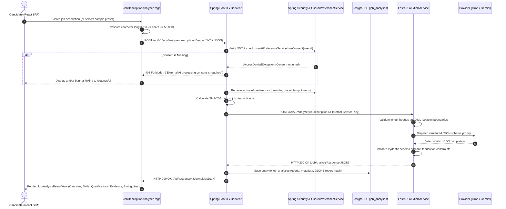

# AI Job Description Analyzer — Technical Architecture & Specification

## 1. Overview & Core Vision

The **AI Job Description Analyzer** transforms job post ingestion and requirements auditing in JobAchiever AI into an objective, evidence-grounded intelligence pipeline. Powered by LLM inference (Groq Cloud as primary, Google Gemini as secondary), the analyzer deconstructs unstructured job postings into structured role definitions, experience constraints, technical skills, certifications, and candidate advisories with absolute factual fidelity.

### Non-Negotiable Core Tenets:
1. **Zero Fabrication & Anti-Hallucination:** The system extracts only qualifications, skills, and constraints explicitly stated in the source text. It never extrapolates or invents salaries, company details, unstated credentials, or required tools. Absent details are explicitly marked `UNKNOWN` or `null`.
2. **Defensive Prompt Injection Boundaries:** Untrusted user-supplied job text is strictly isolated inside `<untrusted_job_description>` XML boundaries with adversarial instruction overrides prohibited.
3. **Strict Human-in-the-Loop & Consent Verification:** External AI inference is prohibited unless the authenticated user has explicitly enabled data processing consent in AI Settings.
4. **Decoupled Architecture:** Spring Boot 3.x is the authoritative owner of identity, tenancy, authorization, persistence, and audit. The Python FastAPI microservice operates as a stateless computation engine.
5. **No Automatic Provider Fallback:** Users manually select their AI provider (Groq or Gemini). The system never automatically switches providers or falls back silently upon failure.
6. **Milestone Boundary Preservation:** This milestone implements Job Description Analysis only. Resume–Job Matching and Skill Gap Correlation are explicitly isolated for subsequent milestones.

---

## 2. End-to-End System Architecture



---

## 3. Data Schema & Decomposition Categories

Every job description is systematically decomposed into 10 structured dimensions:

| Dimension | Description | Extraction Strategy |
| :--- | :--- | :--- |
| **Job Overview** | Role title, hiring company, role category, seniority level, employment type, work arrangement (Remote/Hybrid/On-site), location, and experience range. | Standardized enums (`SENIOR`, `FULL_TIME`, `HYBRID`); normalized min/max years. |
| **Technical Skills** | Strict three-tier categorization: `required` (mandatory must-haves), `preferred` (bonus/nice-to-have), and `mentioned` (contextual). | Clean deduplication, version tags preserved (e.g. "Java 21", "Spring Boot 3"). |
| **Soft Skills** | Teamwork, communication, stakeholder management, technical mentorship, and leadership expectations. | Normalized list without vague generic extrapolation. |
| **Responsibilities** | Direct duties, system ownership, architecture deliverables, and day-to-day operations. | Bulleted breakdown of core role responsibilities. |
| **Qualifications** | Formal education requirements (e.g. BS in CS), accredited certifications, and domain clearances. | Mapped into `education`, `certifications`, and `otherRequirements`. |
| **Tools & Platforms** | Specific databases, CI/CD tools, cloud platforms, and infrastructure technologies. | Dedicated chips for platforms, databases, and DevOps frameworks. |
| **Categorized Keywords** | Core technical, frameworks/tools, domain/industry, soft skills, and role/responsibility keywords. | Grouped for ATS optimization and search indexing. |
| **Atomic Requirements & Evidence** | Granular requirements with importance ratings (`CRITICAL`, `HIGH`, `MEDIUM`, `LOW`), type (`EXPLICIT` / `INFERRED`), section name, and verbatim quote. | Anti-hallucination quotes (`evidenceExcerpt`) anchoring each requirement. |
| **Ambiguities & Red Flags** | Ambiguities, unstated metrics, or missing baseline expectations labeled with neutral candidate advisory tags. | Tagged as `CLARIFICATION_NEEDED`, `POTENTIAL_AMBIGUITY`, or `INCOMPLETE_INFORMATION`. |
| **Summary & Warnings** | High-level role synthesis and extraction notices for truncated or incomplete inputs. | Objective executive overview. |

---

## 4. Database Schema (Flyway Migration V17)

Migration: `backend/src/main/resources/db/migration/V17__create_job_analyses_table.sql`

```sql
CREATE TABLE job_analyses (
    id UUID PRIMARY KEY DEFAULT gen_random_uuid(),
    user_id UUID NOT NULL,
    job_id UUID,
    provider VARCHAR(32) NOT NULL,
    model VARCHAR(128),
    job_title VARCHAR(255),
    company_name VARCHAR(255),
    seniority VARCHAR(32),
    employment_type VARCHAR(32),
    work_arrangement VARCHAR(32),
    location VARCHAR(255),
    experience_summary VARCHAR(255),
    summary TEXT,
    analysis_json JSONB NOT NULL,
    raw_description_hash VARCHAR(64),
    created_at TIMESTAMPTZ NOT NULL DEFAULT CURRENT_TIMESTAMP,
    CONSTRAINT fk_job_analyses_user FOREIGN KEY (user_id)
        REFERENCES users(id) ON DELETE CASCADE,
    CONSTRAINT fk_job_analyses_job FOREIGN KEY (job_id)
        REFERENCES jobs(id) ON DELETE SET NULL
);

CREATE INDEX idx_job_analyses_user_created ON job_analyses (user_id, created_at DESC);
CREATE INDEX idx_job_analyses_user_job_created ON job_analyses (user_id, job_id, created_at DESC);
CREATE INDEX idx_job_analyses_user_hash ON job_analyses (user_id, raw_description_hash);
```

---

## 5. API Endpoints Contract

### Spring Boot Backend (Client-Facing Gateway)
All endpoints require Bearer JWT authentication:

| Method | Path | Description | Response Status |
| :--- | :--- | :--- | :---: |
| `POST` | `/api/v1/jobs/analyze-description` | Decomposes raw job description text (50–50,000 characters). | `200 OK` / `400` / `403` |
| `POST` | `/api/v1/jobs/{jobId}/analyze` | Decomposes an existing saved job posting by ID. | `200 OK` / `404` / `403` |
| `GET` | `/api/v1/jobs/analyses` | Retrieves chronological analysis history for the authenticated user. | `200 OK` |
| `GET` | `/api/v1/jobs/{jobId}/analyses` | Retrieves all analysis reports for a specific job. | `200 OK` |
| `GET` | `/api/v1/jobs/analyses/{analysisId}` | Retrieves full structured analysis details by analysis ID. | `200 OK` / `404` |
| `DELETE` | `/api/v1/jobs/analyses/{analysisId}` | Deletes a job analysis report owned by the authenticated user. | `200 OK` / `404` |

### FastAPI AI Microservice (Internal Only)
Protected by `X-Internal-Service-Key`:

| Method | Path | Description |
| :--- | :--- | :--- |
| `POST` | `/api/v1/analyze/job-description` | Structured extraction with LLM reasoning and schema validation. |
| `POST` | `/api/v1/analyze-job-description` | Route alias for compatibility. |

---

## 6. Verification and Test Results

### 1. Python FastAPI Test Suite:
- **Command:** `pytest`
- **Result:** **109 passed** in 0.64s.
- Includes 7 dedicated test cases in `tests/test_job_analyzer.py` validating Groq extraction, Gemini extraction, alias routes, length constraints, consent enforcement, and internal authentication key verification.

### 2. Main Backend (Spring Boot 3.x) Test Suite:
- **Command:** `mvnw.cmd test`
- **Result:** **246 passed, 0 failures, 0 errors, 1 skipped**.
- Includes 6 schema verification tests in `FlywayMigrationVerificationTests`, 10 unit tests in `JobAnalysisServiceTest`, and 9 integration tests in `JobAnalysisControllerIntegrationTests`.

### 3. Frontend (React 18 + Vitest) Test Suite:
- **Command:** `npm run test -- --run`
- **Result:** **17 test files passed, 103 tests passed** in 7.91s.
- Includes 6 dedicated test cases in `JobDescriptionAnalyzer.test.jsx`.

### 4. Code Quality & Build Sanity:
- **ESLint:** Clean with **0 errors and 0 warnings**.
- **Vite Production Build:** Successfully built with 0 errors (`built in 4.61s`).
