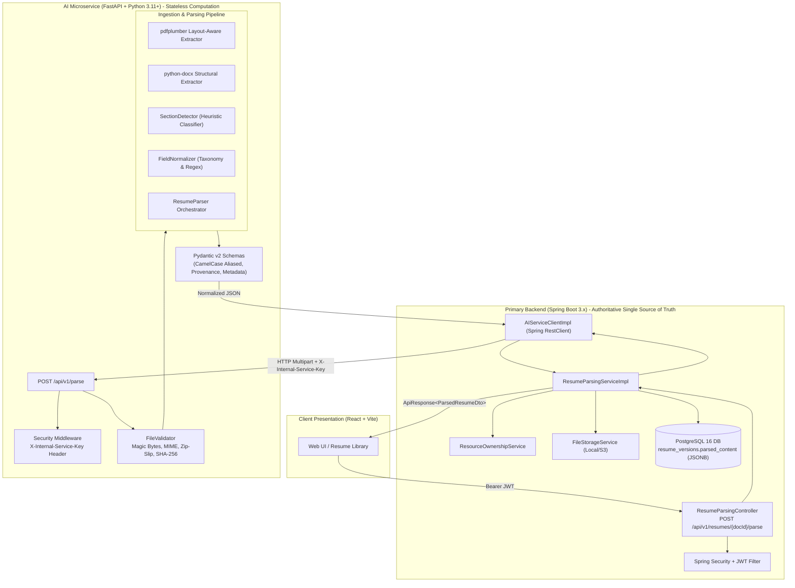

# JobAchiever AI — AI Microservice Architecture & Resume Parsing Pipeline

## Milestone 21 Technical Architecture Document

---

## 1. Architectural Overview

The **JobAchiever AI Microservice** (`ai-service/`) is an internal, stateless computational engine built with **FastAPI** (Python 3.11+). It is decoupled from the authoritative primary backend (**Spring Boot 3.x**) and designed specifically for document structural analysis, text extraction, rule-based normalization, and multi-provider AI reasoning (**Groq Cloud** as Primary, **Google Gemini** as Secondary).



### Core Architectural Axioms
1. **Stateless AI Engine:** The FastAPI service does not maintain databases, user accounts, or persistent file storage. Resumes are processed in-memory or in sandboxed temp files and immediately garbage-collected after response serialization.
2. **Spring Boot as Single Source of Truth:** Spring Boot manages identity, access control, document ownership, and persistent profile state.
3. **Zero Fabrication Policy:** When a piece of information (e.g. phone, degree major, end date) is absent from the resume text, the normalizer leaves it `null`. No facts or achievements are ever synthesized.
4. **Strict Human-in-the-Loop Verification:** Extracted entities are tagged with `verificationStatus: "UNVERIFIED"`. Data remains provisional until the user manually inspects, adjusts, and confirms it into the Master Career Profile graph.
5. **No Tenant Data Leakage:** Parsing requests are transient and strictly separated across internal HTTP execution threads.

---

## 2. Ingestion & Extraction Engine

The ingestion pipeline handles multi-page PDF documents and Microsoft Word DOCX files up to 10MB.

### 2.1 File Validation Layer (`app/utils/file_validation.py`)
Prior to extraction, all uploads undergo multi-layer defensive validation:
- **Magic Byte Verification:**
  - PDF: Initial bytes must match `%PDF-` (`0x25 0x50 0x44 0x46 0x2D`).
  - DOCX: Initial bytes must match PKZip header `PK\003\004` (`0x50 0x4B 0x03 0x04`).
- **MIME & Extension Whitelisting:** Strictly `application/pdf` (`.pdf`) and `application/vnd.openxmlformats-officedocument.wordprocessingml.document` (`.docx`).
- **Zip Slip & Decompression Bomb Guard:** For DOCX files, internal zip member filenames are checked for directory traversal (`..`) and compressed-to-uncompressed expansion ratio limits.
- **Cryptographic Fingerprinting:** Computes SHA-256 hash of the incoming byte stream for deduplication and audit tracking.

### 2.2 Layout-Aware PDF Extraction (`app/services/extraction/pdf_extractor.py`)
- Employs `pdfplumber` to extract layout-preserving text.
- Inspects bounding boxes and page-level streams to maintain visual line integrity.
- Page tracking: Each line is tagged with its origin `page_number` (1-indexed) to establish strict provenance records.
- Empty Document Safeguard: Triggers explicit `422 Unprocessable Entity` if total extracted non-whitespace characters are under 20 characters (guarding against scanned image PDFs requiring OCR).

### 2.3 Structural DOCX Extraction (`app/services/extraction/docx_extractor.py`)
- Utilizes `python-docx` to traverse document block elements.
- **Heading Styles:** Differentiates Heading 1 through Heading 6 from normal body paragraphs.
- **Table Support:** Traverses embedded tables row-by-row, delineating cells with pipe ` | ` separators to preserve tabular skills matrices and education histories.
- Synthesizes virtual line numbering to provide page/line provenance across Word documents.

---

## 3. Section Identification & Rule-Based Parsing

### 3.1 Section Classifier (`app/services/parsing/section_detector.py`)
Resumes vary widely in structure. The classifier scans lines for section heading patterns using weighted keyword matching, font style signals, uppercase ratio, and line length heuristics:

| Detected Section | Primary Heading Keywords |
| :--- | :--- |
| `CONTACT` | Top-of-page candidate banner, contact info, personal details |
| `SUMMARY` | Summary, professional summary, profile, executive summary, objective, about me |
| `EDUCATION` | Education, academic background, qualifications, degrees, university |
| `EXPERIENCE` | Experience, work experience, employment history, career history, professional experience |
| `SKILLS` | Skills, technical skills, core competencies, expertise, tools & technologies |
| `PROJECTS` | Projects, key projects, technical projects, academic projects, open source |
| `CERTIFICATIONS` | Certifications, licenses, credentials, accreditations, courses |
| `PUBLICATIONS` | Publications, research papers, patents, conference proceedings |
| `ACHIEVEMENTS` | Achievements, honors, awards, leadership, extracurriculars |
| `OTHER` | Unclassified text, references, interests, hobbies |

### 3.2 Field Normalization Layer (`app/services/parsing/field_normalizer.py`)
Once text is segmented into section blocks, domain-specific normalizers parse entity records:
- **Personal Information:**
  - Email: RFC 5322 regex extraction.
  - Phone: International and North American phone number patterns.
  - URLs: Targeted extraction for `linkedin.com/in/*`, `github.com/*`, and generic portfolio sites.
  - Location: `City, State` or `City, Country` extraction patterns.
- **Education:**
  - Degree Taxonomy: Standardized classification into `High School`, `Associate`, `Bachelor`, `Master`, `Doctorate`, `Certificate`, `Bootcamp`.
  - Field of Study & Major extraction.
  - Institution detection and graduation date normalization (ISO-8601 `YYYY-MM` or `YYYY`).
  - GPA normalization: standardizes 4.0 / 10.0 scale mentions (e.g. `3.8/4.0`).
- **Work Experience:**
  - Title and Organization extraction.
  - Date Range Normalization: Detects start and end dates (`Jan 2021 - Present`, `2020-03 to 2022-08`), marking `isCurrent` when "Present", "Current", or "Now" appears.
  - Bullet Points: Segregates bulleted impact statements (`•`, `-`, `*`, `–`, numerical).
- **Skills Categorization:**
  - Classifies extracted skills into distinct taxonomies: `LANGUAGE`, `FRAMEWORK`, `DATABASE`, `CLOUD`, `TOOL`, or `GENERAL`.

---

## 4. Pydantic v2 Schema Hierarchy & Provenance

All outgoing payloads conform to strict Pydantic v2 models featuring automatic `to_camel` serialization aliases:

```
ParsedResumeResponse
├── personalInformation: PersonalInfo
│   ├── name, email, phone, location, linkedIn, gitHub, portfolio
│   └── provenance: ProvenanceRecord
├── summary: str
├── education: List[EducationItem]
│   └── institution, degree, fieldOfStudy, degreeType, startDate, endDate, isCurrent, gpa, honors, bullets, provenance
├── skills: List[SkillItem]
│   └── name, category, proficiency, yearsOfExperience, provenance
├── workExperience: List[ExperienceItem]
│   └── organization, title, employmentType, location, startDate, endDate, isCurrent, bullets, technologies, provenance
├── projects: List[ProjectItem]
│   └── title, role, description, url, technologies, bullets, provenance
├── certifications: List[CertificationItem]
│   └── name, issuer, issueDate, expiryDate, credentialId, url, provenance
├── achievements: List[AchievementItem]
│   └── title, description, date, issuer, provenance
├── publications: List[PublicationItem]
│   └── title, publisher, publicationDate, url, authors, provenance
├── otherSections: List[OtherSectionItem]
│   └── sectionTitle, content, bullets, provenance
└── metadata: ResumeMetadata
    ├── fileType, fileSizeBytes, sha256, pageCount, lineCount, wordCount, processingTimeMs, overallConfidence, verificationStatus
```

### Provenance Tracking
Every extracted record includes a `ProvenanceRecord`:
```json
{
  "sourceRawText": "B.S. in Computer Science, Stanford University (2018 - 2022)",
  "pageNumber": 1,
  "lineNumber": 14,
  "confidence": "HIGH"
}
```
Confidence levels are determined algorithmically:
- `HIGH`: Direct regex match on known taxonomy with clean delimiter alignment.
- `MEDIUM`: Section context matches but fields derived from positional heuristics.
- `LOW`: Extracted from ambiguous or unclassified sections.

---

## 5. Spring Boot & FastAPI Integration

### 5.1 Service-to-Service Security
Direct external access to the FastAPI AI service is prohibited. Requests must supply the secret header:
```http
X-Internal-Service-Key: dev-internal-service-key-change-in-production
```
- In development: Sourced from `application.yml` (`app.ai-service.internal-key`) and `ai-service/.env`.
- In production: Injected via Docker secrets or Kubernetes environment variables.
- Missing or invalid keys immediately reject with `401 Unauthorized` (`Invalid or missing internal service key`).

### 5.2 Spring Boot Client Abstraction (`AIServiceClient`)
Spring Boot communicates with FastAPI using `org.springframework.web.client.RestClient`:
- Configured with dedicated connect and read timeouts (default: 30s).
- Streams document bytes via `MultipartBodyBuilder` (`Resource` representation with original filename).
- Handles HTTP 4xx/5xx status codes by wrapping them in `AIServiceException`, which Spring's `GlobalExceptionHandler` converts into clean, client-facing `503 Service Unavailable` API responses without leaking internal stack traces.

### 5.3 Storage & Persistence Flow
When a user calls `POST /api/v1/resumes/{documentId}/parse`:
1. Authenticated user ID is extracted from JWT claims (`@AuthenticationPrincipal UserPrincipal`).
2. `ResourceOwnershipService` ensures the document exists and belongs to the authenticated user.
3. The latest `ResumeVersion` binary is retrieved via `FileStorageService`.
4. `AIServiceClient` streams the file to FastAPI `/api/v1/parse`.
5. FastAPI returns the validated `ParsedResumeResponse`.
6. Spring Boot serializes the response into the version's `parsed_content` JSONB column and updates `processing_status` to `PARSED`.
7. **Important:** The user's `CareerProfile` entity is **not** modified automatically.

---

## 6. Human-in-the-Loop Verification Workflow

In alignment with **AGENTS.md Core Principles**:
- **Step 1: Ingestion & Extraction:** Automated parsing extracts structured candidate information. Every item carries `verificationStatus: "UNVERIFIED"`.
- **Step 2: User Review UI (Resume Studio):** The frontend presents the parsed fields side-by-side with the uploaded PDF/DOCX preview. High-confidence fields are highlighted; low-confidence fields prompt user inspection.
- **Step 3: User Confirmation & Merge:** The user selects which skills, experiences, and education entries to adopt into their Master Career Profile. Only confirmed items transition to `VERIFIED` status in the profile graph.

---

## 7. Quality Assurance & Performance

### 7.1 Automated Testing Metrics
| Test Suite | Framework | Scope | Tests Run | Status |
| :--- | :--- | :--- | :--- | :--- |
| **FastAPI Microservice** | `pytest` + `pytest-asyncio` | API routes, extractors, normalizers, file validation | 43 | **43 Passed** (0.35s) |
| **Spring Boot Backend** | JUnit 5 + Mockito + MockMvc | AI client, parsing service, controller, security | 190 | **190 Passed** (1 skipped) |
| **React Frontend** | Vitest + RTL | UI navigation, validation, context, studio | 82 | **82 Passed** (7.08s) |

### 7.2 Performance Characteristics
- Typical parsing latency for a standard 2-page PDF: **~120ms to 250ms**.
- DOCX parsing latency: **~40ms to 100ms**.
- Memory footprint: In-memory streaming keeps peak memory under 50MB per concurrent request.
