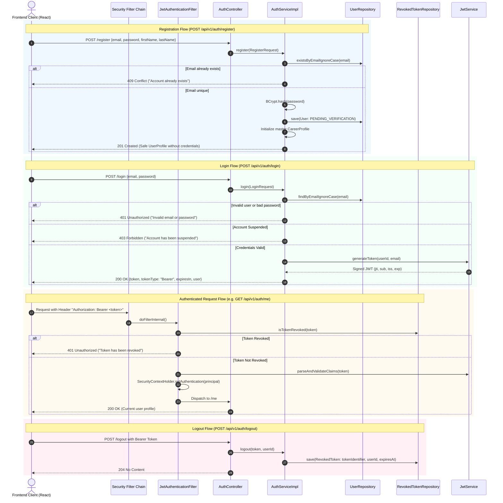

# JobAchiever AI — Authentication & Security Architecture

**Service:** `jobachiever-backend`  
**Standard:** Stateless JWT Bearer Authentication with Server-Side Cryptographic Token Revocation  
**Specification:** Java 21 LTS, Spring Boot 3.3.5, Spring Security 6.x, JJWT 0.12.x, BCrypt  

---

## 1. Overview & Security Principles

The JobAchiever AI authentication subsystem establishes a multi-tenant, cryptographically isolated security perimeter for job seekers:
- **Zero Plaintext Passwords:** Passwords are salted and hashed using BCrypt (`strength = 12`) before persistence. Plaintext passwords are never logged, stored, or cached.
- **Stateless Bearer Tokens:** Authenticated requests utilize signed JWT access tokens containing user identifiers, token IDs (`jti`), and expiry timestamps.
- **Zero Email Enumeration:** Authentication failures (bad email or bad password) emit an identical, generic `401 Unauthorized` response (`"Invalid email or password"`).
- **Practical Revocation on Logout:** Stateless tokens can be revoked immediately on logout via a cryptographic token denylist (`revoked_tokens` table) storing hashed token identifiers (`jti` or SHA-256 digests) rather than raw tokens.
- **Account State Guardrails:** Accounts marked as `SUSPENDED` or `DEACTIVATED` are blocked from authenticating (`403 Forbidden`).

---

## 2. Authentication Lifecycle

---

## 3. JWT Specification & Configuration

- **Library:** `io.jsonwebtoken:jjwt-api:0.12.6` (maintained JJWT with Jackson integration).
- **Algorithm:** HMAC-SHA256 (`HS256`) with minimum 256-bit (32-byte) key.
- **Environment Properties:**
  - `JWT_SECRET` (`app.jwt.secret`): Secret cryptographic signing key.
  - `JWT_EXPIRATION_SECONDS` (`app.jwt.expiration-seconds`): Token lifespan in seconds (default: 86400s / 24 hours).
  - `JWT_ISSUER` (`app.jwt.issuer`): Claim verifying token origin (default: `jobachiever-ai`).
- **Claim Structure:**
  - `sub` (Subject): User's primary UUID (`user.id`).
  - `email`: User's normalized email address.
  - `jti` (JWT ID): Unique UUID generated per issued token.
  - `iss` (Issuer): `jobachiever-ai`.
  - `iat` (Issued At): UTC timestamp of issuance.
  - `exp` (Expiration): UTC timestamp of expiration.

---

## 4. Token Invalidation Architecture (Logout)

Stateless JWT tokens cannot be revoked by client destruction alone. JobAchiever AI implements a secure server-side revocation mechanism:
1. When a client invokes `POST /api/v1/auth/logout`, the server extracts the `jti` claim or SHA-256 digest of the token.
2. The cryptographic token identifier is inserted into the `revoked_tokens` table alongside the user reference and token `expires_at` timestamp.
3. **No raw tokens are stored in the database.**
4. During request evaluation, `JwtAuthenticationFilter` checks the `revoked_tokens` table before setting security authentication.
5. Revoked tokens are immediately rejected with `401 Unauthorized`.
6. An indexed `expires_at` column enables non-blocking automated purging of expired revocation records.

---

## 5. Token Storage Strategy: In-Memory vs. HttpOnly Cookie Trade-offs

| Storage Option | Strengths | Vulnerabilities / Trade-offs | JobAchiever AI Decision |
| :--- | :--- | :--- | :--- |
| **`localStorage` / `sessionStorage`** | Simple client implementation | Vulnerable to Cross-Site Scripting (XSS). Any compromised client script or dependency can exfiltrate tokens. | **Strictly Prohibited** |
| **In-Memory Bearer Token (JavaScript memory)** | Immune to XSS exfiltration across page sessions. | Cleared on page refresh without silent refresh. | **Recommended for Stateless SPA Sessions** |
| **HttpOnly, Secure, SameSite=Strict Cookie** | Inaccessible to JavaScript; immune to XSS token theft. | Requires CSRF protection on mutation requests and careful CORS cookie credentials configuration (`Access-Control-Allow-Credentials: true`). | **Recommended for Long-Lived Refresh Tokens** |

**Platform Architecture Decision:**
- Short-lived Access Tokens are transmitted via `Authorization: Bearer <token>` headers kept in React memory (or managed via Secure, HttpOnly cookie in production deployments).
- Token storage in browser `localStorage` is explicitly prohibited per platform security principles.
