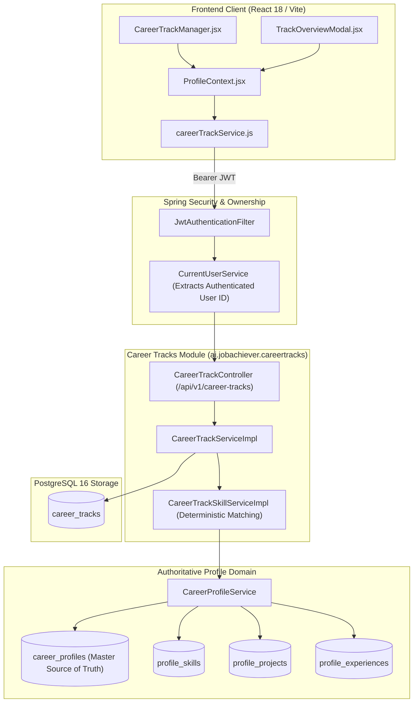

# Career Tracks — Architecture, Data Contracts & API Specification

**Service Version:** 1.0.0-SNAPSHOT  
**Namespace:** `ai.jobachiever.careertracks`  
**Base Path:** `/api/v1/career-tracks`  
**Security Model:** Stateless Bearer JWT, strictly scoped by `CurrentUserService`  

---

## 1. Architectural Overview

**Career Tracks** empower job seekers to manage multiple concurrent career directions—such as *"Full-Stack Engineer"*, *"Engineering Manager"*, or *"Solutions Architect"*—without fragmenting their identity or duplicating their master profile data.

Every career track references a single **Master Career Profile** (`career_profiles`), which acts as the authoritative source of truth for verified skills, education, work history, projects, certifications, and achievements.



---

## 2. Relationship to Master Career Profile

| Property | Behavior & Architectural Guarantee |
| :--- | :--- |
| **Single Source of Truth** | Career tracks **never** duplicate educations, work experiences, projects, or certifications. They store only directional parameters (target role, required/preferred skills, target seniority, target industries, salary expectations, notes). |
| **Referential Integrity** | Each track references both `user_id` and `profile_id` with foreign key constraints (`ON DELETE CASCADE` to user, `ON DELETE SET NULL` to profile). |
| **Independent Lifecycle** | Deleting a career track **never** deletes or alters the master career profile or any profile records (skills, projects, experiences). |
| **Primary Track Promotion** | If a user deletes a track designated as `is_primary = true`, the system automatically queries remaining active tracks and designates the one with the highest priority as the new primary track. |
| **Skill Cross-Referencing** | The `CareerTrackSkillService` calculates skill coverage and gaps dynamically by comparing track requirements against the live master profile skills graph. |

---

## 3. Relational Schema & Flyway Migrations

The schema was initialized in `V1__init_schema.sql` and enhanced in `V13__enhance_career_tracks_attributes.sql`:

```sql
CREATE TABLE IF NOT EXISTS career_tracks (
    id UUID PRIMARY KEY DEFAULT gen_random_uuid(),
    user_id UUID NOT NULL REFERENCES users(id) ON DELETE CASCADE,
    profile_id UUID REFERENCES career_profiles(id) ON DELETE SET NULL,
    name VARCHAR(100) NOT NULL,
    target_role VARCHAR(100) NOT NULL,
    target_seniority VARCHAR(50),
    industry VARCHAR(100),
    industries JSONB,
    min_salary NUMERIC(12,2),
    target_salary NUMERIC(12,2),
    currency VARCHAR(3) DEFAULT 'USD',
    is_active BOOLEAN NOT NULL DEFAULT true,
    is_primary BOOLEAN NOT NULL DEFAULT false,
    priority INTEGER NOT NULL DEFAULT 1,
    required_skills JSONB,
    preferred_skills JSONB,
    career_goals TEXT,
    notes TEXT,
    created_at TIMESTAMP WITH TIME ZONE NOT NULL DEFAULT CURRENT_TIMESTAMP,
    updated_at TIMESTAMP WITH TIME ZONE NOT NULL DEFAULT CURRENT_TIMESTAMP
);

CREATE INDEX IF NOT EXISTS idx_career_tracks_user ON career_tracks(user_id);
CREATE INDEX IF NOT EXISTS idx_career_tracks_user_priority ON career_tracks(user_id, priority);
```

### Constraints & Validation Rules:
- **Max Active Tracks:** Configurable maximum of 10 active tracks per user (`jobachiever.career-tracks.max-active-tracks=10`).
- **Unique Track Name:** Track names must be case-insensitively unique per user.
- **Unique Active Target Role:** Users cannot create or activate multiple tracks with the same active target role (case-insensitive).
- **Priority Bounds:** Integer value between `1` (highest priority) and `100` (lowest priority).

---

## 4. REST API Endpoints Specification

All endpoints require `Authorization: Bearer <JWT>`. User identity is extracted server-side via `CurrentUserService`.

### 4.1 List Career Tracks
- **Endpoint:** `GET /api/v1/career-tracks`
- **Query Parameters:**
  - `active` *(optional, Boolean)*: Filter by active status (`true` / `false`). If omitted, returns all tracks.
  - `page` *(optional, Integer, default 0)*: Zero-based page index.
  - `size` *(optional, Integer, default 20)*: Page size limit.
- **Response `200 OK`:**
```json
{
  "content": [
    {
      "id": "e39dc1d2-05f4-4df1-8e0f-13a84e334351",
      "userId": "9b1deb4d-3b7d-4bad-9bdd-2b0d7b3dcb6d",
      "profileId": "f784a9e3-2f2d-45f8-8bb2-8610eb675bb2",
      "name": "Full-Stack Development",
      "targetRole": "Full-Stack Engineer",
      "targetSeniority": "Senior",
      "industry": "Software / SaaS",
      "industries": ["Fintech", "Developer Tools"],
      "minSalary": 140000.00,
      "targetSalary": 170000.00,
      "currency": "USD",
      "active": true,
      "primary": true,
      "priority": 1,
      "requiredSkills": ["Java", "Spring Boot", "React", "PostgreSQL"],
      "preferredSkills": ["Docker", "Kubernetes", "AWS"],
      "careerGoals": "Lead full-stack engineering initiatives on distributed SaaS platforms.",
      "notes": "Primary target for Q1 2027 job search.",
      "createdAt": "2026-11-15T10:00:00Z",
      "updatedAt": "2026-11-15T10:00:00Z"
    }
  ],
  "page": 0,
  "size": 20,
  "totalElements": 1,
  "totalPages": 1,
  "last": true
}
```

---

### 4.2 Get Career Track by ID
- **Endpoint:** `GET /api/v1/career-tracks/{trackId}`
- **Security:** Returns `404 Not Found` if the track does not exist or belongs to another user (anti-enumeration).
- **Response `200 OK`:** Returns `CareerTrackResponse`.

---

### 4.3 Create Career Track
- **Endpoint:** `POST /api/v1/career-tracks`
- **Request Body (`CreateCareerTrackRequest`):**
```json
{
  "name": "Solutions Architecture",
  "targetRole": "Cloud Solutions Architect",
  "targetSeniority": "Lead / Principal",
  "industry": "Cloud Infrastructure",
  "industries": ["Enterprise Software", "Cloud Consulting"],
  "minSalary": 180000.00,
  "targetSalary": 210000.00,
  "currency": "USD",
  "primary": false,
  "priority": 2,
  "requiredSkills": ["AWS", "Kubernetes", "System Design"],
  "preferredSkills": ["Terraform", "Security Architecture"],
  "careerGoals": "Transition from tech lead to enterprise architecture.",
  "notes": "Focus on high-availability cloud migration cases."
}
```
- **Response `201 Created`:** Returns created `CareerTrackResponse`.
- **Error Codes:**
  - `400 Bad Request`: Validation failure (blank name, blank target role, invalid priority).
  - `409 Conflict`: Track name already exists or active target role already exists.
  - `422 Unprocessable Entity`: Maximum active tracks limit exceeded.

---

### 4.4 Update Career Track
- **Endpoint:** `PUT /api/v1/career-tracks/{trackId}`
- **Request Body (`UpdateCareerTrackRequest`):**
```json
{
  "name": "Staff Solutions Architecture",
  "targetRole": "Principal Solutions Architect",
  "targetSeniority": "Principal",
  "industry": "Enterprise Cloud",
  "industries": ["Enterprise Software"],
  "minSalary": 190000.00,
  "targetSalary": 230000.00,
  "currency": "USD",
  "primary": false,
  "priority": 2,
  "requiredSkills": ["AWS", "Kubernetes", "System Design", "Kafka"],
  "preferredSkills": ["Terraform", "Go"],
  "careerGoals": "Lead organization-wide cloud architecture.",
  "notes": "Updated scope."
}
```
- **Response `200 OK`:** Returns updated `CareerTrackResponse`.
- **Note:** Cannot reassign `userId` or `profileId`.

---

### 4.5 Update Track Activation Status
- **Endpoint:** `PATCH /api/v1/career-tracks/{trackId}/status`
- **Request Body (`UpdateTrackStatusRequest`):**
```json
{
  "active": true
}
```
- **Response `200 OK`:** Returns updated `CareerTrackResponse`.
- **Validation:** When activating (`active = true`), enforces the 10 active tracks limit and checks for active target role conflicts.

---

### 4.6 Update Track Priority
- **Endpoint:** `PATCH /api/v1/career-tracks/{trackId}/priority`
- **Request Body (`UpdateTrackPriorityRequest`):**
```json
{
  "priority": 1
}
```
- **Response `200 OK`:** Returns updated `CareerTrackResponse`.
- **Validation:** Priority must be between `1` and `100`.

---

### 4.7 Delete Career Track
- **Endpoint:** `DELETE /api/v1/career-tracks/{trackId}`
- **Response `204 No Content`**
- **Safety Guarantee:** Deletes the track safely. Does not delete or affect the master profile. Promotes the next highest priority track to primary if deleted track was primary.

---

### 4.8 Deterministic Career Track Overview & Skill Match
- **Endpoint:** `GET /api/v1/career-tracks/{trackId}/overview`
- **Response `200 OK` (`CareerTrackOverviewResponse`):**
```json
{
  "trackId": "e39dc1d2-05f4-4df1-8e0f-13a84e334351",
  "trackName": "Full-Stack Development",
  "targetRole": "Full-Stack Engineer",
  "targetSeniority": "Senior",
  "priority": 1,
  "active": true,
  "primary": true,
  "skillMatch": {
    "overallMatchPercentage": 75,
    "requiredSkillsCount": 4,
    "matchedRequiredSkillsCount": 3,
    "preferredSkillsCount": 3,
    "matchedPreferredSkillsCount": 2,
    "matchedRequiredSkills": ["java", "spring boot", "react"],
    "missingRequiredSkills": ["postgresql"],
    "matchedPreferredSkills": ["docker", "kubernetes"],
    "missingPreferredSkills": ["aws"],
    "additionalProfileSkills": ["typescript", "tailwind css", "redis"],
    "readinessStatus": "READY"
  },
  "relevantProjects": [
    {
      "id": "a1b2c3d4-...",
      "title": "Cloud Job Tracker",
      "technologies": ["React", "Spring Boot", "PostgreSQL"],
      "matchingSkills": ["react", "spring boot", "postgresql"],
      "relevanceScore": 3
    }
  ],
  "relevantExperiences": [
    {
      "id": "e5f6g7h8-...",
      "company": "Tech Corp",
      "role": "Senior Software Engineer",
      "description": "Built resilient Java and Spring Boot microservices.",
      "skillsUsed": ["Java", "Spring Boot"],
      "relevanceScore": 2
    }
  ]
}
```

---

## 5. Skill Matching Engine & Canonical Aliases

The `CareerTrackSkillService` provides deterministic, zero-fabrication skill matching between career track requirements and the user's master profile skills.

### 5.1 Skill Normalization & Canonical Aliases
All skills are trimmed, lower-cased, and mapped to canonical forms:

| Raw / Alias Variant | Canonical Form |
| :--- | :--- |
| `react.js`, `reactjs` | `react` |
| `vue.js`, `vuejs` | `vue` |
| `node.js`, `nodejs` | `node` |
| `angular.js`, `angularjs` | `angular` |
| `k8s` | `kubernetes` |
| `postgres` | `postgresql` |
| `mongo` | `mongodb` |
| `springboot` | `spring boot` |
| `gcp` | `google cloud` |
| `typescript`, `ts` | `typescript` |
| `javascript`, `js` | `javascript` |

### 5.2 Deterministic Scoring Formula
The match percentage is calculated with a **70% weight on required skills** and a **30% weight on preferred skills**:

$$\text{Score} = (\text{Required Ratio} \times 70) + (\text{Preferred Ratio} \times 30)$$

- If no preferred skills are specified, required skills constitute 100% of the score.
- If no required skills are specified, preferred skills constitute 100% of the score.
- If neither are specified, match percentage is 100% (no requirements to fail).

### 5.3 Readiness Classification
- **`READY`**: Match $\ge 80\%$
- **`NEEDS_PREPARATION`**: $50\% \le \text{Match} < 80\%$
- **`SKILL_GAP`**: Match $< 50\%$

---

## 6. Multi-Tenancy & Authorization Hardening

1. **Server-Side Identity:** User IDs are **never** accepted from request bodies or URL path parameters. The authenticated user ID is obtained solely through `CurrentUserService.getCurrentUserId()`.
2. **Access Isolation:** Queries enforce `findByUserIdAndId(userId, trackId)`. If a user attempts to access or mutate a track owned by another user, the server returns `404 Not Found`, preventing ID enumeration.
3. **No Cross-Tenant Data Leaks:** Track listings, counts, and overview match calculations are strictly scoped to the caller's `user_id`.

---

## 7. Frontend Integration

1. **`careerTrackService.js`:**
   - Provides `listCareerTracks()`, `getCareerTrack()`, `createCareerTrack()`, `updateCareerTrack()`, `updateTrackStatus()`, `updateTrackPriority()`, `deleteCareerTrack()`, and `getTrackOverview()`.
   - Includes graceful offline demo fallback when backend services are offline.
2. **`TrackOverviewModal.jsx`:**
   - Interactive dialog displaying overall skill match percentage with color-coded badges (`READY`, `NEEDS_PREPARATION`, `SKILL_GAP`).
   - Detailed breakdowns for Matched Required Skills, Missing Required Skills, Matched Preferred Skills, and Additional Profile Strengths.
   - Summaries of relevant master profile projects and experiences.
3. **`CareerTrackManager.jsx`:**
   - Track cards with priority badges, status toggles, inline overview trigger buttons, and confirmation dialogs for deletions.
4. **`ProfileContext.jsx`:**
   - Extended with `toggleTrackStatus`, `updateTrackPriority`, and `getTrackSkillMatch` state management methods.

---

## 8. Verification & Test Coverage

The Career Tracks subsystem is covered by 30 backend automated tests:
- **`CareerTrackSkillServiceTest.java` (5 unit tests):** Canonical alias matching, weighted scoring formulas, empty edge cases, and relevant project/experience scoring.
- **`CareerTrackServiceUnitTest.java` (8 unit tests):** Max active track limit (10), duplicate track name rejection, duplicate active target role rejection, primary track promotion on delete, ownership isolation.
- **`CareerTrackControllerIntegrationTests.java` (17 integration tests):** Full MockMvc integration testing covering GET, POST, PUT, PATCH status, PATCH priority, DELETE, and GET overview endpoints with validation error cases and 404 security checks.
- **`FlywayMigrationVerificationTests.java`:** Verifies V13 migration script integrity.
- **Frontend Vitest (`careerTracks.test.jsx`):** 6 tests validating track rendering, modal trigger, skill match rendering, and local state modifications.
