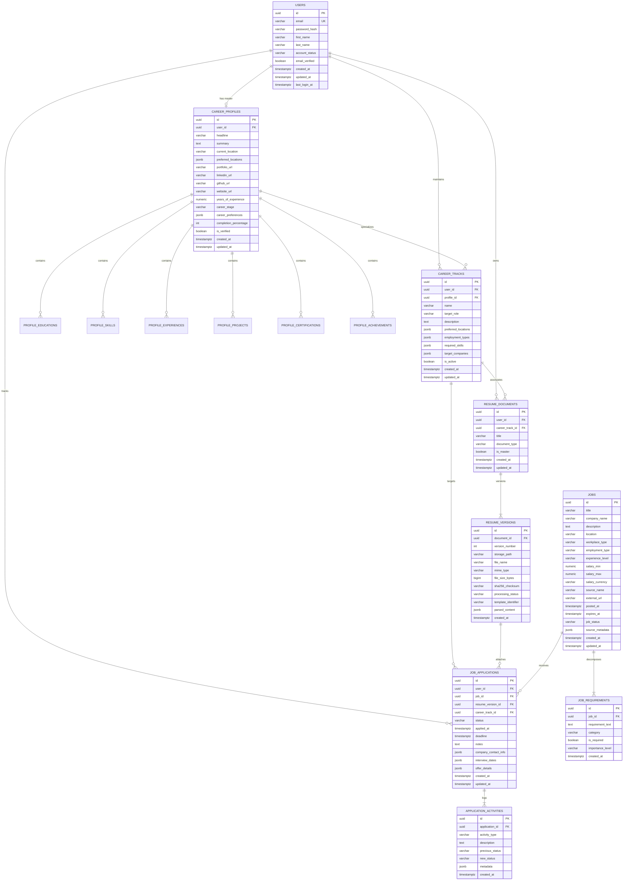

# JobAchiever AI — Core Database Schema Documentation

**Database:** PostgreSQL 16 LTS  
**Migration Engine:** Flyway 10.x  
**Persistence Framework:** Spring Data JPA / Hibernate 6.x  
**Primary Key Standard:** UUID (`gen_random_uuid()`)  

---

## 1. Architectural Overview & Entity-Relationship Model

The JobAchiever AI relational schema establishes the single source of truth for user career personas, Master Career Profiles, multi-track career paths, versioned resume documents, shared market opportunities, and multi-stage application pipelines.

### Entity-Relationship Diagram

---

## 2. Table Catalog & Detailed Specifications

### 2.1 User Accounts (`users`)
Stores core identity and credentials.
- **`id` (UUID PK):** Unique user identifier.
- **`email` (VARCHAR(255) NOT NULL):** Unique lowercase user email address.
- **`password_hash` (VARCHAR(255) NOT NULL):** Salted cryptographic hash (BCrypt/Argon2). Never stored in plaintext.
- **`first_name`, `last_name` (VARCHAR(100) NOT NULL):** Real user name.
- **`account_status` (VARCHAR(32) NOT NULL):** Constrained to `ACTIVE`, `PENDING_VERIFICATION`, `SUSPENDED`, `DEACTIVATED`.
- **`email_verified` (BOOLEAN NOT NULL):** Explicit verification state.
- **`created_at`, `updated_at`, `last_login_at` (TIMESTAMPTZ):** Audit timestamps.
- **Unique Constraint:** `uq_users_email_lower` on `LOWER(email)`.

### 2.2 Master Career Profile (`career_profiles`)
The canonical single source of professional truth for a user.
- **1-to-1 Relationship:** Exactly one profile per user enforced via `CONSTRAINT uq_career_profiles_user_id UNIQUE (user_id)` with `ON DELETE CASCADE`.
- **`headline`, `summary`, `current_location`, `portfolio_url`, `linkedin_url`, `github_url`, `website_url`:** Professional contact and summary attributes.
- **`years_of_experience` (NUMERIC(4,1)):** Calculated or declared experience.
- **`career_stage` (VARCHAR(50)):** Constrained to `STUDENT`, `ENTRY_LEVEL`, `MID_LEVEL`, `SENIOR`, `LEAD`, `EXECUTIVE`, `CAREER_SWITCHER`.
- **`career_preferences` (JSONB):** Flexible metadata for work authorization, salary expectations, and relocation preferences.
- **`completion_percentage` (INTEGER):** Progress indicator constrained between 0 and 100.
- **`is_verified` (BOOLEAN):** Guardrail flag indicating human verification of AI-extracted facts.

### 2.3 Master Profile Child Entities
Preserves granular, structured career data rather than opaque monolithic JSON:
1. **`profile_educations`:** Degrees, institutions, GPA, dates, study field.
2. **`profile_skills`:** Technical, soft, tool, and domain competencies with proficiency levels (`BEGINNER`, `INTERMEDIATE`, `ADVANCED`, `EXPERT`) and verification flags. Unique per profile on `(profile_id, LOWER(name))`.
3. **`profile_experiences`:** Work history, roles, dates, employment types, and bullet achievements.
4. **`profile_projects`:** Portfolio projects, URLs, GitHub repositories, and technology arrays.
5. **`profile_certifications`:** Industry credentials, issuing organizations, dates, and credential URLs.
6. **`profile_achievements`:** Awards, publications, hackathon wins, and leadership recognitions.

### 2.4 Multi-Track Personas (`career_tracks`)
Enables users to maintain distinct, targeted career personas (e.g. "Full Stack Developer", "Solutions Architect", "Engineering Manager") without duplicating master education or experience.
- **`user_id`, `profile_id`:** Dual references guaranteeing user isolation and profile alignment (`ON DELETE CASCADE`).
- **`name`, `target_role`:** Distinct persona titles.
- **`required_skills`, `preferred_locations`, `employment_types`, `target_companies` (JSONB):** Track-specific target filters.
- **Unique Constraint:** `(user_id, name)` prevents duplicate track names per user.

### 2.5 Resumes & Versioning (`resume_documents`, `resume_versions`)
Manages both uploaded physical resumes and dynamically generated/tailored ATS resumes:
- **`resume_documents`:** Parent document envelope linked to a user and optional career track. Type is `UPLOADED`, `GENERATED`, or `TAILORED`.
- **`resume_versions`:** Version history (`version_number`).
  - **`storage_path`:** Internal secure storage URI/path (e.g., `storage/{userId}/resumes/{uuid}.pdf`). Never public URLs.
  - **`sha256_checksum`:** Integrity validation and duplicate detection.
  - **`processing_status`:** `PENDING`, `PARSING`, `PARSED`, `FAILED`.
  - **`template_identifier`:** Visual design template ID.
  - **`parsed_content` (JSONB):** Structured extracted metadata from the AI extraction pipeline.
  - **Unique Constraint:** `(document_id, version_number)`.

### 2.6 Shared Job Catalog & Requirements (`jobs`, `job_requirements`)
Shared platform repository of job listings:
- **`jobs`:** Not restricted to single users; represents shared market opportunities.
  - Workplace types: `REMOTE`, `HYBRID`, `ON_SITE`.
  - Employment types: `FULL_TIME`, `PART_TIME`, `CONTRACT`, `INTERNSHIP`.
  - Experience levels: `ENTRY_LEVEL`, `MID_LEVEL`, `SENIOR`, `LEAD`, `EXECUTIVE`.
  - Salary ranges and external listing URLs.
- **`job_requirements`:** Granular decomposed requirements:
  - Categories: `SKILL`, `EDUCATION`, `EXPERIENCE`, `CERTIFICATION`, `LANGUAGE`, `OTHER`.
  - `is_required` (Boolean): Distinguishes hard requirements from preferred bonus criteria.
  - `importance_level`: `CRITICAL`, `HIGH`, `MEDIUM`, `LOW`.

### 2.7 Application Pipeline & History (`job_applications`, `application_activities`)
User-specific application tracking pipeline:
- **`job_applications`:**
  - Belongs to `users` (`ON DELETE CASCADE`).
  - References `jobs` (`ON DELETE RESTRICT` to protect active application history).
  - References attached `resume_versions` and aligned `career_tracks` (`ON DELETE SET NULL`).
  - Statuses: `SAVED`, `APPLIED`, `ASSESSMENT`, `INTERVIEW`, `OFFER`, `REJECTED`, `WITHDRAWN`.
  - Unique Constraint: `(user_id, job_id)` prevents accidental duplicate tracker rows for the same opportunity.
- **`application_activities`:**
  - Audit trail of stage changes, scheduled interviews, and notes.
  - References `job_applications` (`ON DELETE CASCADE`).

---

## 3. Indexing Strategy

| Index Name | Table | Columns | Purpose |
| :--- | :--- | :--- | :--- |
| `uq_users_email_lower` | `users` | `LOWER(email)` | Fast, case-insensitive authentication & uniqueness |
| `idx_users_account_status` | `users` | `account_status` | Filter active vs suspended accounts |
| `idx_career_profiles_user_id` | `career_profiles` | `user_id` | Fast 1-to-1 profile retrieval |
| `idx_profile_skills_profile_id` | `profile_skills` | `profile_id` | Skills list queries per profile |
| `idx_profile_skills_name` | `profile_skills` | `name` | Skill matching against job requirements |
| `idx_career_tracks_user_id` | `career_tracks` | `user_id` | User track list queries |
| `idx_resume_documents_user_id` | `resume_documents` | `user_id` | User document library queries |
| `idx_resume_versions_document_id`| `resume_versions` | `document_id` | Version history lookups |
| `idx_jobs_title`, `idx_jobs_company_name` | `jobs` | `title`, `company_name` | Opportunity search & filtering |
| `idx_job_applications_user_status`| `job_applications` | `user_id, status` | Kanban board column queries |

---

## 4. Deletion Behavior & Data Integrity

- **Cascade Deletes (`ON DELETE CASCADE`):** Used where child entities have no semantic meaning outside their parent container (e.g., deleting a User cascades to their Profile, Tracks, Resumes, and Applications; deleting a Profile cascades to its Educations, Skills, and Experiences).
- **Nullify Deletes (`ON DELETE SET NULL`):** Used where references are optional contextual associations (e.g., deleting a Career Track sets `career_track_id` to NULL on associated resumes and applications without deleting the resumes or applications).
- **Restrict Deletes (`ON DELETE RESTRICT`):** Used on `jobs` in `job_applications`. A job cannot be deleted if a user is actively tracking an application for it.

---

## 5. Flyway Migrations Sequence

Migrations are located in `backend/src/main/resources/db/migration/`:

1. `V1__create_database_extensions.sql`: Enables `uuid-ossp`, `pgcrypto`, and conditionally initializes `vector` (pgvector).
2. `V2__create_user_accounts.sql`: Creates `users` table and case-insensitive email index.
3. `V3__create_career_profiles.sql`: Creates `career_profiles` master profile table.
4. `V4__create_profile_details.sql`: Creates structured child profile entities (`profile_educations`, `profile_skills`, etc.).
5. `V5__create_career_tracks.sql`: Creates `career_tracks` for multi-track management.
6. `V6__create_resume_documents.sql`: Creates `resume_documents` and `resume_versions`.
7. `V7__create_jobs_and_requirements.sql`: Creates shared `jobs` catalog and decomposed `job_requirements`.
8. `V8__create_job_applications.sql`: Creates `job_applications` pipeline and `application_activities` audit log.

---

## 6. Future pgvector Extension Considerations

- **Extension State:** Initialized via `V1__create_database_extensions.sql`.
- **Future Vector Columns:** When AI embeddings are integrated in subsequent milestones, semantic vectors will be added via clean incremental migrations (e.g., `V9__add_job_requirement_embeddings.sql`, `V10__add_profile_skill_embeddings.sql`):
  - Column type: `vector(768)` or `vector(1536)` (matching Gemini or open embedding models).
  - Indexing: HNSW (Hierarchical Navigable Small World) index for sub-linear cosine similarity queries (`vector_cosine_ops`).
