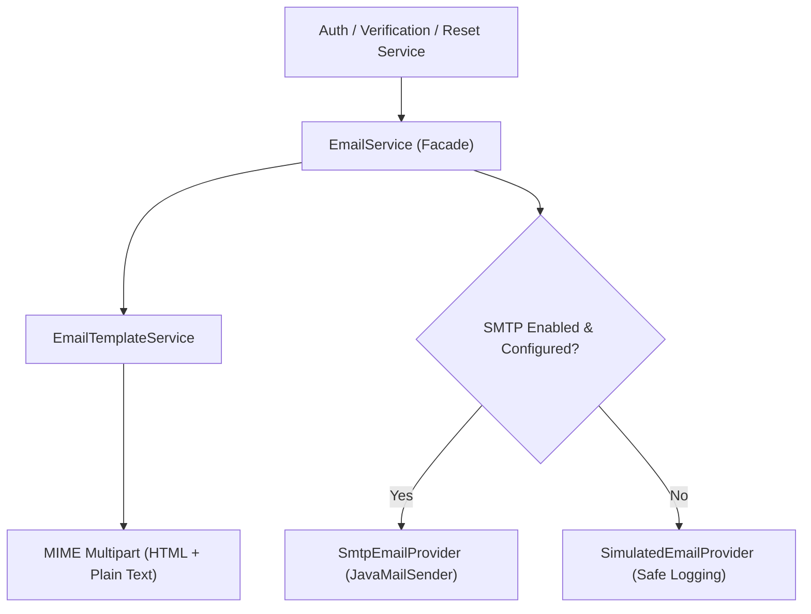

# Email Verification and Password Recovery Architecture

## 1. Overview & Security Posture

JobAchiever AI provides a robust, zero-trust account verification and password recovery subsystem designed to defend against user enumeration, timing side-channels, brute-force guessing, and token leakage.

### Security Guarantees
- **No Plaintext Storage:** Neither 6-digit verification OTPs nor 32-byte password reset tokens are stored in plain text. Only their cryptographically secure SHA-256 hex digests (`otp_hash` and `token_hash`) are persisted in PostgreSQL.
- **Constant-Time Comparison:** All token and OTP validations use `MessageDigest.isEqual(...)` over SHA-256 byte digests, eliminating timing attacks that could reveal correct prefix digits.
- **Zero Account Enumeration:** Both resend OTP and forgot-password endpoints respond with identical, generic HTTP 200 OK success messages regardless of whether the submitted email address exists in the database.
- **Strict Single-Use & Expiration:** Every token is single-use and bound to a strict expiration timestamp (default: 15 minutes for OTPs, 30 minutes for password reset tokens). Consumed or expired tokens are immediately rejected.
- **Attempt Limiting:** OTP verification is restricted to a maximum of 5 attempts. Exceeding the threshold automatically invalidates the token, requiring the user to request a new one.
- **Request Throttling & Cooldown:** OTP resend requests enforce a minimum 60-second cooldown window. Early requests are rejected with `HTTP 429 Too Many Requests`.
- **Zero Confidential Logging:** Plaintext OTPs, reset tokens, and user passwords are never written to application logs, audit logs, or exception traces.
- **Isolated Delivery Abstraction:** Email delivery is fully decoupled behind an `EmailProvider` interface. In environments without SMTP credentials (e.g. local dev, test suites, offline staging), the system seamlessly runs in `SIMULATED` mode, logging delivery metadata without sending actual network requests.

---

## 2. Relational Database Schema (`V10__create_verification_and_reset_tokens.sql`)

### `email_verification_tokens`
| Column | Type | Constraints / Defaults | Description |
| :--- | :--- | :--- | :--- |
| `id` | `UUID` | `PRIMARY KEY DEFAULT gen_random_uuid()` | Unique token identifier |
| `user_id` | `UUID` | `NOT NULL REFERENCES users(id) ON DELETE CASCADE` | Owner user ID |
| `otp_hash` | `VARCHAR(64)` | `NOT NULL` | SHA-256 hex hash of 6-digit OTP |
| `expires_at` | `TIMESTAMPTZ` | `NOT NULL` | UTC expiration timestamp (15m) |
| `attempts_count` | `INT` | `NOT NULL DEFAULT 0` | Failed attempts counter |
| `max_attempts` | `INT` | `NOT NULL DEFAULT 5` | Maximum permissible attempts |
| `consumed_at` | `TIMESTAMPTZ` | `NULL` | Timestamp when successfully consumed |
| `created_at` | `TIMESTAMPTZ` | `NOT NULL DEFAULT CURRENT_TIMESTAMP` | Token creation timestamp |

### `password_reset_tokens`
| Column | Type | Constraints / Defaults | Description |
| :--- | :--- | :--- | :--- |
| `id` | `UUID` | `PRIMARY KEY DEFAULT gen_random_uuid()` | Unique reset token identifier |
| `user_id` | `UUID` | `NOT NULL REFERENCES users(id) ON DELETE CASCADE` | Target user ID |
| `token_hash` | `VARCHAR(64)` | `NOT NULL UNIQUE` | SHA-256 hex hash of 32-byte reset token |
| `expires_at` | `TIMESTAMPTZ` | `NOT NULL` | UTC expiration timestamp (30m) |
| `consumed_at` | `TIMESTAMPTZ` | `NULL` | Timestamp when successfully consumed |
| `created_at` | `TIMESTAMPTZ` | `NOT NULL DEFAULT CURRENT_TIMESTAMP` | Token generation timestamp |

---

## 3. Endpoints & REST API Contracts

### A. Email Verification
- **Path:** `POST /api/v1/auth/verify-email` (alias: `POST /api/v1/auth/verify-otp`)
- **Public Route:** Yes (permitAll)
- **Request Body:**
  ```json
  {
    "email": "candidate@example.com",
    "otp": "482910"
  }
  ```
- **Responses:**
  - `200 OK`: `{"success": true, "message": "Email successfully verified. Your account is now active."}`
  - `400 Bad Request`: Invalid OTP, attempt limit exceeded, or expired code.

### B. Resend Verification OTP
- **Path:** `POST /api/v1/auth/resend-verification` (alias: `POST /api/v1/auth/resend-otp`)
- **Public Route:** Yes (permitAll)
- **Request Body:**
  ```json
  {
    "email": "candidate@example.com"
  }
  ```
- **Responses:**
  - `200 OK`: `{"success": true, "message": "If an account exists with this email address, a new verification code has been dispatched."}`
  - `429 Too Many Requests`: Cooldown active (`"Please wait 45 seconds before requesting a new verification code."`)

### C. Forgot Password Request
- **Path:** `POST /api/v1/auth/forgot-password`
- **Public Route:** Yes (permitAll)
- **Request Body:**
  ```json
  {
    "email": "candidate@example.com"
  }
  ```
- **Responses:**
  - `200 OK`: `{"success": true, "message": "If an account exists with this email address, password reset instructions have been dispatched."}`

### D. Reset Password
- **Path:** `POST /api/v1/auth/reset-password`
- **Public Route:** Yes (permitAll)
- **Request Body:**
  ```json
  {
    "token": "3a7b9c1d5e2f4a6b8c0d1e3f5a7b9c1d3a7b9c1d5e2f4a6b8c0d1e3f5a7b9c1d",
    "newPassword": "NewStr0ngP@ssw0rd2026!"
  }
  ```
- **Responses:**
  - `200 OK`: `{"success": true, "message": "Password successfully reset. You may now log in with your new credentials."}`
  - `400 Bad Request`: Password validation failure (does not meet complexity requirements).
  - `401 Unauthorized`: Token invalid, already consumed, or expired.

---

## 4. Email Notification Architecture



### Configuration Parameters
```yaml
app:
  mail:
    enabled: ${MAIL_ENABLED:false}
    from: ${MAIL_FROM:noreply@jobachiever.ai}
    from-name: ${MAIL_FROM_NAME:JobAchiever AI}
    reset-base-url: ${RESET_BASE_URL:http://localhost:5173/reset-password}
    otp-expiration-minutes: 15
    reset-token-expiration-minutes: 30
    resend-cooldown-seconds: 60
    max-otp-attempts: 5
```
