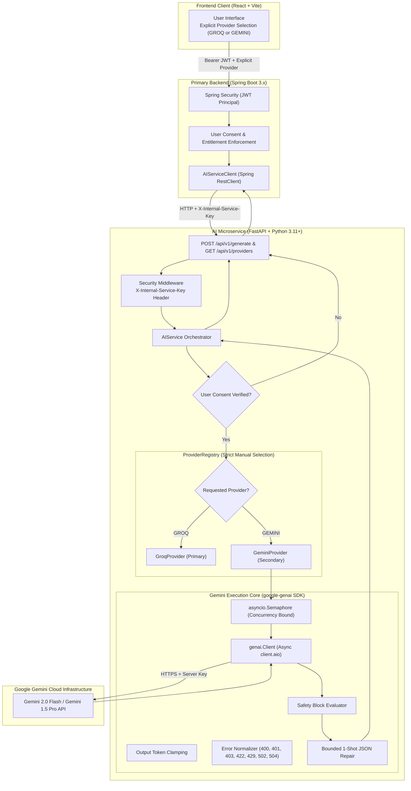

# JobAchiever AI — Google Gemini AI Provider Integration

## Milestone 23 Architecture & Technical Guide

---

## 1. Executive Overview

This document details the integration of **Google Gemini** as the platform's secondary AI inference engine, building directly on the provider-independent AI architecture established in Milestone 22.

The architecture allows job seekers to manually select between **Groq Cloud** (Primary) and **Google Gemini** (Secondary) depending on their preferences for speed, reasoning depth, or provider ecosystem. Both providers implement the identical abstract provider contract (`BaseLLMProvider`), guaranteeing consistent business logic, structured JSON handling, token usage reporting, and error normalization.



---

## 2. Core Architectural Decisions

1. **Groq as Primary, Gemini as Secondary:** Groq remains the default and primary inference engine. Gemini provides secondary high-context multimodal reasoning.
2. **Unified Provider Abstraction:** `GeminiProvider` implements `BaseLLMProvider`. No domain business logic is duplicated between providers.
3. **Strict Manual Selection:** The user explicitly identifies their choice via `provider: "GEMINI"`. If omitted, the request defaults to `GROQ`.
4. **Zero Silent Fallback:** If Gemini fails (due to quota, rate limits, invalid keys, or timeouts), the error is surfaced directly. The platform **never** silently retries on Groq.
5. **Server-Side Key Isolation:** `GEMINI_API_KEY` is loaded exclusively on the backend (`ai-service/.env`). Keys are never sent to the client, never returned in API payloads, and masked in diagnostic logs.
6. **Zero Career Fact Fabrication:** Anti-hallucination guardrails command models to extract and generate information strictly grounded in verified user achievements.
7. **Explicit User Consent:** Career or resume data is never transmitted to Google without explicit user consent (`userConsent: true`).
8. **Decoupled Configuration:** If Gemini is unconfigured on a server (`GEMINI_API_KEY=None`), Groq continues to function normally. Requests selecting Gemini will return a clear 400 Bad Request error.

---

## 3. SDK & Configuration

### 3.1 Official SDK
The integration utilizes Google's official Python SDK:
```
google-genai==3.3.0
```
This is the modern, official Google GenAI SDK providing native async support (`client.aio.models.generate_content`) and structured output configuration.

### 3.2 Environment Variables
Configured in `ai-service/.env` (modeled via `app/core/ai_config.py`):

| Variable | Type | Default | Description |
| :--- | :---: | :--- | :--- |
| `GEMINI_API_KEY` | `string` | *None* | Google Gemini API key (`AIzaSy...`). |
| `GEMINI_DEFAULT_MODEL` | `string` | `gemini-2.0-flash` | Default model for text and structured generation. |
| `GEMINI_TIMEOUT_SECONDS` | `float` | `30.0` | Per-request timeout limit. |
| `GEMINI_MAX_OUTPUT_TOKENS`| `int` | `4096` | Upper bound for generation output tokens. |
| `GEMINI_MAX_CONCURRENCY` | `int` | `10` | Concurrency ceiling enforced via `asyncio.Semaphore`. |

---

## 4. Supported Google Gemini Models

Models are defined in [model_config.py](file:///c:/Projects/JobAchieverAI/ai-service/app/core/model_config.py):

| Model Identifier | Display Name | Context Window | Max Output | Strengths & Workload |
| :--- | :--- | :---: | :---: | :--- |
| **`gemini-2.0-flash`** *(Default)* | Gemini 2.0 Flash | 1,048,576 tokens (1M) | 8,192 tokens | High-speed multimodal generation, real-time structured output, and fast phrasing. |
| **`gemini-1.5-pro`** | Gemini 1.5 Pro | 2,097,152 tokens (2M) | 8,192 tokens | Deep contextual reasoning across large career portfolios and academic CVs. |
| **`gemini-1.5-flash`** | Gemini 1.5 Flash | 1,048,576 tokens (1M) | 8,192 tokens | Cost-effective, high-throughput text transformation. |

*Model names are never hardcoded throughout the application; requests dynamically validate models against `GEMINI_SUPPORTED_MODELS`.*

---

## 5. API Endpoints

### 5.1 Provider Discovery
- **Endpoint:** `GET /api/v1/providers`
- **Authentication:** None required
- **Response (200 OK):**
```json
{
  "providers": [
    {
      "id": "GROQ",
      "name": "Groq Cloud",
      "priority": "PRIMARY",
      "available": true,
      "configured": true,
      "default": true,
      "status": "CONFIGURED",
      "connectionStatus": "CONFIGURED",
      "supportedModels": [
        "llama-3.3-70b-versatile",
        "llama-3.1-8b-instant",
        "mixtral-8x7b-32768",
        "gemma2-9b-it"
      ],
      "defaultModel": "llama-3.3-70b-versatile"
    },
    {
      "id": "GEMINI",
      "name": "Google Gemini",
      "priority": "SECONDARY",
      "available": true,
      "configured": true,
      "default": false,
      "status": "CONFIGURED",
      "connectionStatus": "CONFIGURED",
      "supportedModels": [
        "gemini-2.0-flash",
        "gemini-1.5-pro",
        "gemini-1.5-flash"
      ],
      "defaultModel": "gemini-2.0-flash"
    }
  ]
}
```

### 5.2 Generation Request
- **Endpoint:** `POST /api/v1/generate`
- **Authentication:** `X-Internal-Service-Key: <secret>`
- **Request (Text Generation with Gemini):**
```json
{
  "provider": "GEMINI",
  "model": "gemini-2.0-flash",
  "task": "TEXT_GENERATION",
  "prompt": "Synthesize a 3-bullet technical summary highlighting cloud architecture and Kubernetes.",
  "systemPrompt": "You are an executive talent strategist.",
  "temperature": 0.2,
  "maxTokens": 1024,
  "userConsent": true
}
```
- **Response (200 OK):**
```json
{
  "provider": "GEMINI",
  "model": "gemini-2.0-flash",
  "content": "• Architected high-availability Kubernetes clusters...",
  "jsonData": null,
  "usage": {
    "inputTokens": 28,
    "outputTokens": 84,
    "totalTokens": 112
  },
  "finishReason": "STOP",
  "validationWarnings": [],
  "processingTimeMs": 185.4
}
```

---

## 6. Structured Output Handling

- **Native JSON Configuration:** Configures `types.GenerateContentConfig(response_mime_type="application/json")`.
- **Markdown Stripping:** Regex utility automatically strips code fences (` ```json ... ``` `) if returned.
- **Bounded 1-Shot Repair:** If the initial completion fails JSON parsing, a single repair prompt asks Gemini to fix syntax errors without modifying data.
- **Zero Fabrication:** If JSON remains invalid, raises `StructuredOutputError` (`422 Unprocessable Entity`). No simulated data is invented.

---

## 7. Error Handling & HTTP Mapping

| Exception | HTTP Code | Meaning |
| :--- | :---: | :--- |
| `UnsupportedProviderError` | `400 Bad Request` | Unrecognized provider or Gemini requested when unconfigured on the server. |
| `UserConsentRequiredError` | `400 Bad Request` | User has not explicitly consented to external AI transmission. |
| `InvalidModelError` | `400 Bad Request` | Model ID not supported for Gemini. |
| `AIProviderError (Safety)` | `422 Unprocessable` | Gemini blocked the completion due to safety policy restrictions. |
| `StructuredOutputError` | `422 Unprocessable` | Gemini failed to produce valid JSON output after bounded 1-shot repair. |
| `ProviderRateLimitError` | `429 Too Many Requests` | Gemini quota or rate limit exceeded. |
| `ProviderAuthenticationError` | `502 Bad Gateway` | Upstream Gemini API key is invalid or unauthorized (HTTP 401/403). |
| `ProviderServiceUnavailableError` | `503 Service Unavailable` | Google Gemini upstream service outage or disconnect (HTTP 500/502/503). |
| `ProviderTimeoutError` | `504 Gateway Timeout` | Gemini request exceeded timeout threshold. |

---

## 8. Privacy & Data Handling

- **API Key Masking:** `SensitiveDataFilter` masks `AIza[0-9A-Za-z-_]{35}` in logs.
- **Prompt Sanitization:** Prompts are never logged at INFO level.
- **In-Memory Streaming:** No prompt contents or completion payloads are persisted to disk in `ai-service/`.
- **Third-Party Processing Disclosure:** Google processes data according to Google Cloud and Gemini API terms of service. Explicit consent is verified prior to dispatch.

---

## 9. Automated Testing Verification

The Gemini provider implementation is verified across 95 automated tests in `ai-service/tests/`:
- **Provider Tests (`test_gemini_provider.py`):** 14 tests covering initialization, missing key, valid text, structured JSON, markdown stripping, JSON repair, authentication error, rate limit, quota exhaustion, timeout, safety block, invalid model, service failure, output token enforcement, and streaming.
- **Registry Tests (`test_provider_registry.py`):** 8 tests verifying explicit Gemini resolution, explicit Groq resolution, unconfigured rejection, default provider, Ollama exclusion, and zero automatic fallback.
- **API Tests (`test_generation_api.py`):** 13 tests verifying Gemini text generation, no silent fallback on failure, credential masking, and provider discovery.
