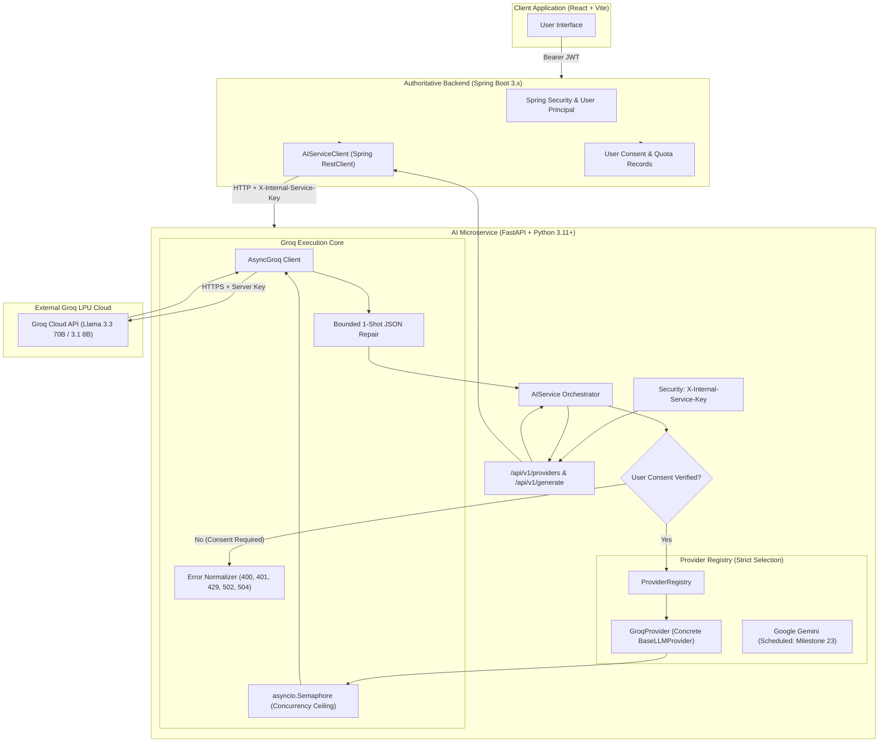

# JobAchiever AI — Groq AI Provider Integration

## Milestone 22 Architecture & Technical Guide

---

## 1. Executive Overview

This document specifies the provider-independent AI architecture of JobAchiever AI and details the integration of **Groq Cloud** as the platform's primary AI inference engine.

The architecture decouples business features (career strategy, resume critique, cover letter generation) from concrete LLM providers. Groq serves as the first production provider, running on Language Processing Units (LPUs) to achieve ultra-low latency inference for high-quality career advice.



---

## 2. Core Architecture Principles

1. **Groq as Primary Provider:** Groq provides high-throughput, low-latency execution for interactive user workflows.
2. **Provider-Independent Abstraction:** All AI capabilities invoke `BaseLLMProvider`. Providers implement common text, structured JSON, and streaming interfaces.
3. **Strict Manual Selection:** The user explicitly selects their desired provider (e.g., `provider: "GROQ"`).
4. **Zero Silent Fallback:** The platform **never** automatically routes requests to another provider when Groq fails or rate limits are reached. Failures are reported directly and transparently to the user.
5. **Server-Side Key Isolation:** Provider API keys are configured exclusively on the server (`ai-service/.env`). Keys are never sent to the client, never returned by APIs, and redacted from diagnostic logs.
6. **Zero Career Fact Fabrication:** Prompts command strict anti-hallucination guardrails. Missing fields remain `null`.
7. **Explicit User Consent:** Career or resume data is never transmitted to external providers without verified user consent (`userConsent: true`).

---

## 3. Configuration & Environment Variables

All Groq parameters are configured in `ai-service/.env` (modeled via `ai-service/app/core/ai_config.py`):

| Variable | Type | Default | Description |
| :--- | :---: | :--- | :--- |
| `GROQ_API_KEY` | `string` | *None* | Server-side Groq Cloud API key (`gsk_...`). |
| `GROQ_DEFAULT_MODEL` | `string` | `llama-3.3-70b-versatile` | Default model for text generation and structured analysis. |
| `GROQ_TIMEOUT_SECONDS` | `float` | `30.0` | Per-request network timeout. |
| `GROQ_MAX_RETRIES` | `int` | `2` | Maximum retries for transient errors (429, 503, network disconnects). |
| `GROQ_MAX_OUTPUT_TOKENS`| `int` | `4096` | Upper bound for generation output tokens. |
| `GROQ_MAX_CONCURRENCY` | `int` | `10` | Concurrency ceiling enforced via `asyncio.Semaphore`. |

---

## 4. Supported Groq Models

Models are defined in `app/core/model_config.py`:

| Model ID | Display Name | Context Window | Max Output | Best Suited For |
| :--- | :--- | :---: | :---: | :--- |
| `llama-3.3-70b-versatile` | Llama 3.3 70B Versatile *(Default)* | 128k | 32k | Deep resume critique, career roadmapping, STAR-method interview feedback. |
| `llama-3.1-8b-instant` | Llama 3.1 8B Instant | 128k | 8k | Fast text rewriting, bullet point phrasing, real-time interactive adjustments. |
| `mixtral-8x7b-32768` | Mixtral 8x7B | 32k | 4k | High-throughput structured parsing and categorization. |
| `gemma2-9b-it` | Gemma 2 9B IT | 8k | 4k | Compact instruction-tuned task execution. |

---

## 5. API Endpoints

### 5.1 Provider Metadata
- **Endpoint:** `GET /api/v1/providers`
- **Authentication:** Public / Internal Gateway
- **Response (200 OK):**
```json
{
  "providers": [
    {
      "id": "GROQ",
      "name": "Groq Cloud",
      "available": true,
      "default": true,
      "status": "CONFIGURED",
      "supportedModels": [
        "llama-3.3-70b-versatile",
        "llama-3.1-8b-instant",
        "mixtral-8x7b-32768",
        "gemma2-9b-it"
      ],
      "defaultModel": "llama-3.3-70b-versatile"
    },
    {
      "id": "GEMINI",
      "name": "Google Gemini",
      "available": false,
      "default": false,
      "status": "NOT_CONFIGURED",
      "supportedModels": [
        "gemini-2.0-flash",
        "gemini-1.5-pro"
      ],
      "defaultModel": "gemini-2.0-flash"
    }
  ]
}
```

### 5.2 Generation Endpoint
- **Endpoint:** `POST /api/v1/generate`
- **Authentication:** `X-Internal-Service-Key: <secret>`
- **Request (Text Mode):**
```json
{
  "provider": "GROQ",
  "model": "llama-3.3-70b-versatile",
  "task": "TEXT_GENERATION",
  "prompt": "Draft an executive summary for a Principal Systems Architect.",
  "systemPrompt": "You are a senior career advisor. Be concise and metric-focused.",
  "temperature": 0.2,
  "maxTokens": 1024,
  "userConsent": true
}
```
- **Request (Structured JSON Mode):**
```json
{
  "provider": "GROQ",
  "task": "STRUCTURED_OUTPUT",
  "responseFormat": "json",
  "prompt": "Extract competencies from the resume text into JSON.",
  "userConsent": true
}
```
- **Response (200 OK):**
```json
{
  "provider": "GROQ",
  "model": "llama-3.3-70b-versatile",
  "content": "...",
  "jsonData": { ... },
  "usage": {
    "inputTokens": 45,
    "outputTokens": 180,
    "totalTokens": 225
  },
  "finishReason": "STOP",
  "validationWarnings": [],
  "processingTimeMs": 142.3
}
```

---

## 6. Error Handling & HTTP Mapping

| Exception | HTTP Code | Meaning & Client Action |
| :--- | :---: | :--- |
| `UnsupportedProviderError` | `400 Bad Request` | Requested provider is unrecognized or not yet available (e.g. Gemini requested prior to Prompt 23). |
| `UserConsentRequiredError` | `400 Bad Request` | User has not explicitly consented to external AI processing. |
| `InvalidModelError` | `400 Bad Request` | Model ID is not supported for the requested provider. |
| `StructuredOutputError` | `422 Unprocessable` | Provider failed to produce valid JSON after bounded 1-shot repair. |
| `ProviderRateLimitError` | `429 Too Many Requests` | Groq quota/rate limit reached. Includes `Retry-After` header when provided. |
| `ProviderAuthenticationError` | `502 Bad Gateway` | Server Groq API key is invalid or revoked. Do not retry automatically. |
| `ProviderServiceUnavailableError` | `503 Service Unavailable` | Upstream Groq network disconnect or 5xx outage. |
| `ProviderTimeoutError` | `504 Gateway Timeout` | Groq request exceeded configured timeout limit. |

---

## 7. Privacy & Data Handling Safeguards

1. **Redacted Logging:** `SensitiveDataFilter` in `app/core/logging.py` sanitizes log streams, masking Groq API keys (`gsk_...`), Bearer tokens, phone numbers, and email addresses.
2. **No Prompt Stash:** High-level prompts containing sensitive user resumes are never logged verbatim at INFO level; only metadata (length, provider, model, latency) is recorded.
3. **In-Memory Operation:** Prompts and generated outputs are kept strictly in memory during the request lifecycle.

---

## 8. Spring Boot Integration

The primary backend interacts via `AIServiceClient`:
- Dispatches authenticated requests with `X-Internal-Service-Key`.
- Propagates user provider preference (`AIGenerationRequestDto.provider`).
- Maps HTTP status codes into typed domain exceptions (`AIServiceException`).
- Ensures zero provider API keys or internal stack traces reach the React client.

---

## 9. Google Gemini Integration (Milestone 23)

Google Gemini has been integrated as the platform's secondary AI provider (see `docs/gemini-integration.md`):
- Implemented in `app/providers/gemini_provider.py` conforming strictly to `BaseLLMProvider`.
- Configured via `GEMINI_API_KEY` and `GEMINI_DEFAULT_MODEL` (`gemini-2.0-flash`).
- Users can explicitly select either `provider: "GROQ"` (Primary) or `provider: "GEMINI"` (Secondary).
- Both providers share the exact same generation request/response schemas, structured JSON validation, and error normalization without code duplication. Zero automatic fallback is maintained between providers.
