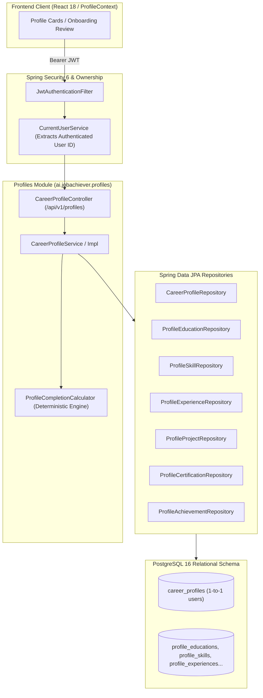

# Master Career Profile — Architecture, Data Contracts & API Specification

**Service Version:** 1.0.0-SNAPSHOT  
**Namespace:** `ai.jobachiever.profiles`  
**Base Path:** `/api/v1/profiles`  
**Security Model:** Stateless Bearer JWT, strictly scoped by `CurrentUserService`  

---

## 1. Architectural Overview

The **Master Career Profile** is the central, authoritative career graph within JobAchiever AI. It represents the verified, comprehensive record of a job seeker's professional life—consolidating personal branding, educational milestones, technical & soft skills, professional work history, portfolio projects, verified credentials, achievements, and career preferences.



---

## 2. Core Design & Security Principles

1. **Strict User Ownership (Tenancy Guarantee):**
   - Profile endpoints **never** accept a `userId` in path variables, query parameters, or request bodies.
   - The user identity is extracted solely from the validated JWT token via `CurrentUserService.getAuthenticatedUserId()`.
   - Access to unauthenticated requests is denied with `401 Unauthorized`.
2. **Immutable Primary Identifiers & Email Protection:**
   - The user's registered email address is strictly read-only within profile responses.
   - Attempting to modify the email address via `PUT /api/v1/profiles/me` or `PATCH /api/v1/profiles/me` is rejected with `400 Bad Request`. Email changes must go through account verification flows.
3. **Auto-Initialization on First Access:**
   - If a newly registered user accesses `GET /api/v1/profiles/me`, the system automatically provisions an initial default `CareerProfile` record linked to their `User` entity, avoiding unhandled 404s.
4. **Transactional Idempotency:**
   - `PUT /api/v1/profiles/me` and `PATCH /api/v1/profiles/me` execute within atomic transactions (`@Transactional`), ensuring child records (educations, skills, experiences, projects, certs, achievements) and completion metrics update consistently or roll back completely.
5. **Zero Fabrication:**
   - No mock or placeholder data is generated by the backend. All data persisted reflects user-provided or user-verified information.

---

## 3. Data Sections & Relational Mapping

| Section | Database Table | Key Attributes & Validations |
| :--- | :--- | :--- |
| **Personal Information** | `career_profiles` & `users` | `fullName` (updates user first/last name), `headline` (max 255), `phone_number` (max 50), `country` (max 100), `current_location` (max 255), social links (`linkedin_url`, `github_url`, `portfolio_url`, `website_url`). Email is read-only. |
| **Professional Summary** | `career_profiles` | `headline`, `summary` (TEXT), `career_stage` (`STUDENT`, `ENTRY_LEVEL`, `MID_LEVEL`, `SENIOR`, `LEAD`, `EXECUTIVE`, `CAREER_SWITCHER`), `years_of_experience` (NUMERIC 4,1). |
| **Education** | `profile_educations` | `institution` (required), `degree` (required), `field_of_study`, `start_date`, `end_date`, `is_current`, `grade_or_gpa`, `description` (coursework). Rejects `end_date < start_date`. |
| **Skills** | `profile_skills` | `name` (required, deduplicated case-insensitively), `category` (`TECHNICAL`, `SOFT`, `TOOL`, `LANGUAGE`, `DOMAIN`), `proficiency_level` (`BEGINNER`, `INTERMEDIATE`, `ADVANCED`, `EXPERT`), `years_of_experience`, `is_verified`. |
| **Work Experience** | `profile_experiences` | `company_name` (required), `job_title` (required), `location`, `employment_type`, `start_date`, `end_date`, `is_current`, `description`, `achievements` (JSONB). Rejects `end_date < start_date`. |
| **Projects** | `profile_projects` | `title` (required), `role`, `start_date`, `end_date`, `is_current`, `description`, `technologies` (JSONB), `project_url`, `github_url`. Rejects `end_date < start_date`. |
| **Certifications** | `profile_certifications`| `name` (required), `issuing_organization` (required), `issue_date`, `expiration_date`, `credential_id`, `credential_url`. Rejects `expiration_date < issue_date`. |
| **Achievements** | `profile_achievements` | `title` (required), `description`, `achievement_date`, `issuer`. |
| **Career Preferences**| `career_profiles` | Stored in `career_preferences` JSONB: `targetRoles`, `employmentTypes`, `workArrangement`, `preferredLocations`, `preferredCountries`, `expectedSalary`, `careerGoals`. |

---

## 4. Deterministic Profile Completion Engine

Profile completeness is calculated deterministically across 8 distinct sections. Each section evaluates presence and quality criteria without relying on non-deterministic models:

### Standard Scoring Matrix (Mid-to-Senior & Professional Profiles)
| Section | Weight | Criteria for Full Score |
| :--- | :--- | :--- |
| **Personal Information** | 15% | Headline (5%) + Location/Country (5%) + Professional Link (5%) |
| **Professional Summary** | 10% | Summary text $\ge$ 20 characters (10%), partial text (5%) |
| **Education** | 15% | At least 1 complete education record (institution + degree) |
| **Skills** | 15% | 1 skill (5%), 2 skills (10%), $\ge$ 3 skills with proficiency (15%) |
| **Work Experience** | 15% | At least 1 complete work experience record |
| **Projects** | 15% | At least 1 complete project record |
| **Certifications & Achievements** | 5% | At least 1 certification OR 1 achievement record |
| **Career Preferences** | 10% | Target roles, employment types, or career goals defined |
| **Total** | **100%** | |

### Adaptive Redistribution for Students & Early Career Professionals
To empower college students, interns, and career switchers without penalizing them for a lack of corporate tenure:
- When `careerStage` is `STUDENT` or `ENTRY_LEVEL` and no corporate work experience records exist:
  - **Work Experience weight (15%) is waived (0%)** with status `"Waived for Student/Entry-Level profile"`.
  - **Projects weight is increased to 25%** (+10%).
  - **Education weight is increased to 20%** (+5%).
  - **Total remains 100%**, enabling students and freshers to achieve 100% profile completeness through exemplary coursework and capstone projects.

---

## 5. REST API Endpoint Specification

### 1. `GET /api/v1/profiles/me`
Retrieves the authenticated user's master career profile.

**Headers:**
```http
Authorization: Bearer <access_token>
```

**Success Response (200 OK):**
```json
{
  "success": true,
  "message": "Profile retrieved successfully",
  "data": {
    "id": "1c7d2426-3829-4e78-9e12-421b8fcd4520",
    "userId": "59b299d3-9a46-4948-bb88-30113c23e85a",
    "email": "jane.doe@example.com",
    "personalInfo": {
      "fullName": "Jane Doe",
      "headline": "Senior Full-Stack Engineer",
      "email": "jane.doe@example.com",
      "phone": "+1 (555) 234-5678",
      "country": "United States",
      "location": "San Francisco, CA",
      "linkedinUrl": "https://linkedin.com/in/janedoe",
      "githubUrl": "https://github.com/janedoe",
      "portfolioUrl": "https://janedoe.dev",
      "websiteUrl": "https://janedoe.dev",
      "summary": "Passionate full-stack engineer with 5+ years experience."
    },
    "professionalSummary": {
      "headline": "Senior Full-Stack Engineer",
      "summary": "Passionate full-stack engineer with 5+ years experience.",
      "careerStage": "MID_LEVEL",
      "yearsOfExperience": 5.0
    },
    "education": [...],
    "skills": [...],
    "experience": [...],
    "projects": [...],
    "certifications": [...],
    "achievements": [...],
    "careerPreferences": {
      "targetRoles": ["Senior Backend Engineer", "Solutions Architect"],
      "employmentTypes": ["Full-time"],
      "workArrangement": "Hybrid",
      "preferredLocations": ["San Francisco Bay Area", "Remote"],
      "expectedSalary": "$150,000 - $180,000",
      "careerGoals": "Lead high-throughput backend systems."
    },
    "completionPercentage": 100,
    "verified": false,
    "createdAt": "2026-11-15T12:00:00Z",
    "updatedAt": "2026-11-15T12:05:00Z"
  },
  "timestamp": "2026-11-15T12:05:01Z"
}
```

---

### 2. `PUT /api/v1/profiles/me`
Idempotently creates or updates the complete career profile and child records.

**Request Payload:**
```json
{
  "personalInfo": {
    "fullName": "Jane Doe",
    "headline": "Senior Full-Stack Engineer & Architect",
    "phone": "+1-555-234-5678",
    "country": "United States",
    "location": "San Francisco, CA",
    "linkedinUrl": "https://linkedin.com/in/janedoe",
    "githubUrl": "https://github.com/janedoe",
    "summary": "Full-stack engineer with 5+ years designing distributed systems in Spring Boot and React."
  },
  "professionalSummary": {
    "headline": "Senior Full-Stack Engineer & Architect",
    "summary": "Full-stack engineer with 5+ years designing distributed systems in Spring Boot and React.",
    "careerStage": "SENIOR",
    "yearsOfExperience": 5.5
  },
  "education": [
    {
      "institution": "UC Berkeley",
      "degree": "B.S. EECS",
      "fieldOfStudy": "Computer Science",
      "startDate": "2018-09-01",
      "endDate": "2022-05-31",
      "gradeOrGpa": "3.85",
      "description": "Algorithms, Operating Systems, Database Internals"
    }
  ],
  "skills": [
    { "name": "Java 21", "category": "TECHNICAL", "proficiencyLevel": "EXPERT", "yearsOfExperience": 5 },
    { "name": "Spring Boot 3", "category": "TECHNICAL", "proficiencyLevel": "EXPERT", "yearsOfExperience": 5 },
    { "name": "PostgreSQL", "category": "TECHNICAL", "proficiencyLevel": "ADVANCED", "yearsOfExperience": 4 }
  ],
  "experience": [...],
  "projects": [...],
  "certifications": [...],
  "achievements": [...],
  "careerPreferences": { ... }
}
```

---

### 3. `PATCH /api/v1/profiles/me`
Performs partial updates on designated profile sections without overwriting omitted sections with nulls.

---

### 4. `GET /api/v1/profiles/me/completion`
Returns granular breakdown of section weights, earned points, completion flags, and actionable recommendations.

**Success Response (200 OK):**
```json
{
  "success": true,
  "message": "Profile completion calculated successfully",
  "data": {
    "completionPercentage": 85,
    "completedSections": [
      "Personal Information",
      "Professional Summary",
      "Education",
      "Skills",
      "Projects",
      "Certifications & Achievements",
      "Career Preferences"
    ],
    "incompleteSections": [
      "Work Experience"
    ],
    "sectionBreakdown": [
      {
        "section": "Personal Information",
        "weight": 15,
        "earned": 15,
        "completed": true,
        "details": "Complete contact info and social links"
      },
      {
        "section": "Work Experience",
        "weight": 15,
        "earned": 0,
        "completed": false,
        "details": "No work experience records added"
      }
    ],
    "recommendations": [
      "Add your work history to demonstrate domain experience."
    ]
  },
  "timestamp": "2026-11-15T12:05:02Z"
}
```
