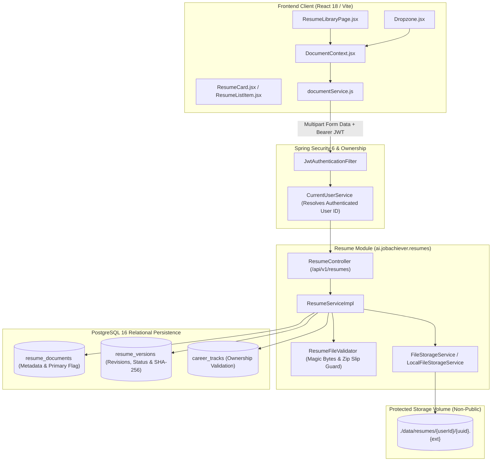
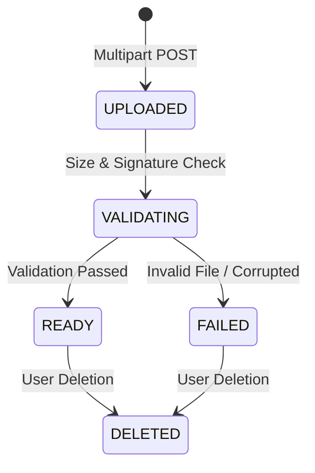

# Secure Resume Document Management & Storage Architecture

**Service Version:** 1.0.0-SNAPSHOT  
**Namespace:** `ai.jobachiever.resumes`  
**Base Path:** `/api/v1/resumes`  
**Security Model:** Stateless Bearer JWT, strictly scoped by `CurrentUserService`  

---

## 1. Architectural Overview

The **Resume Document Management** subsystem provides secure binary persistence, metadata indexing, format validation, revision history tracking, in-browser previews, and multi-track association for candidate resumes in **JobAchiever AI**.



---

## 2. Storage Architecture & Decoupling

The platform decouples business logic from physical storage through the `FileStorageService` abstraction:

```java
public interface FileStorageService {
    String store(InputStream inputStream, String storageKey);
    Resource retrieve(String storageKey);
    boolean delete(String storageKey);
    boolean exists(String storageKey);
}
```

### 2.1 Local Storage Implementation (`LocalFileStorageService`)
- Files are saved outside the public web root in a protected directory (default: `./data/resumes/`).
- **Internal Storage Keys:** Files are keyed by `${userId}/${UUID}.${extension}`, never using client-provided original filenames as on-disk paths.
- **Path Traversal Prevention:** The service normalizes paths and enforces that all resolved filesystem targets are strict subpaths of `rootStorageLocation`. Leading slashes, relative traversal patterns (`..`), or illegal characters immediately trigger a `FileStorageException`.
- **Compensating Rollback:** If database persistence fails after a file has been written to disk, the service automatically performs a compensating delete of the stored file, preventing orphaned binary accumulation.
- **Privacy Protection:** Physical disk paths and server directory structures are **never** returned in API responses or logs.

### 2.2 S3 & Cloud Object Storage Migration Considerations
Because all persistence operations use the `FileStorageService` abstraction, migrating to Amazon S3, Google Cloud Storage, or MinIO requires zero changes to `ResumeServiceImpl` or `ResumeController`:
1. Implement `S3FileStorageService implements FileStorageService` using AWS SDK v2 (`S3Client`).
2. Map `storageKey` directly to S3 object keys (`bucket/resumes/{userId}/{uuid}.{ext}`).
3. Configure the active implementation via Spring `@ConditionalOnProperty(name = "app.storage.type", havingValue = "s3")`.

---

## 3. Deep File Validation & Security Engine

The `ResumeFileValidator` enforces strict defense-in-depth on every upload:

| Check | Constraint | Failure Response |
| :--- | :--- | :--- |
| **Max Size** | 10 MB (`10,485,760` bytes) | `400 Bad Request` ("File size exceeds limit") |
| **Empty File** | $\le 0$ bytes | `400 Bad Request` ("File is missing or empty") |
| **Extension** | Only `.pdf` and `.docx` | `400 Bad Request` ("Unsupported file extension") |
| **Declared MIME** | `application/pdf`, `application/vnd.openxmlformats-...` | `400 Bad Request` ("MIME type mismatch") |
| **PDF Magic Bytes** | First 5 bytes must be `%PDF-` (`0x25 0x50 0x44 0x46 0x2D`) | `400 Bad Request` ("File signature mismatch") |
| **DOCX Magic Bytes** | First 4 bytes must be `PK\003\004` (`0x50 0x4B 0x03 0x04`) | `400 Bad Request` ("Missing PK signature") |
| **Zip Slip Defense** | Archive entries checked for `..` or leading `/` | `400 Bad Request` ("Invalid archive entry path") |
| **Zip Bomb Defense** | Inspects up to 100 entries without extracting to disk | `400 Bad Request` |
| **DOCX Structure** | Must contain `[Content_Types].xml` or `word/document.xml` | `400 Bad Request` ("Malformed DOCX document") |
| **Integrity Check** | Real-time SHA-256 computation (hex encoded 64-char) | Stored with revision record |

---

## 4. Document Processing Lifecycle

Each revision records an explicit lifecycle status:



- **`UPLOADED`**: Received by the backend endpoint.
- **`VALIDATING`**: Undergoing magic byte signature and structure verification.
- **`READY`**: Fully validated, safely persisted in storage, and available for download/preview.
- **`FAILED`**: Rejected due to format corruption or invalid signature.
- **`DELETED`**: Document deleted and purged from storage.

*(Note: AI parsing statuses `PARSING` and `PARSED` are reserved for Milestone 16+ integration with the FastAPI microservice).*

---

## 5. REST API Endpoints Specification

All endpoints are hosted under `/api/v1/resumes` and require `Authorization: Bearer <JWT>`.

### 5.1 Upload Resume (`POST /api/v1/resumes`)
- **Content-Type:** `multipart/form-data`
- **Parameters:**
  - `file` *(MultipartFile, required)*: PDF or DOCX file ($\le 10$ MB).
  - `title` / `displayName` *(String, optional)*: Display name for the document.
  - `description` *(String, optional)*: User notes or summary.
  - `careerTrackId` *(UUID, optional)*: Target career persona ID (must belong to authenticated user).
  - `templateIdentifier` *(String, optional)*: Resume template ID if applicable.
- **Response (`201 Created`):**
```json
{
  "data": {
    "id": "c71e8a2b-4d3f-4e1b-9f2a-7d8e6c5b4a3f",
    "userId": "9b1deb4d-3b7d-4bad-9bdd-2b0d7b3dcb6d",
    "careerTrackId": "e39dc1d2-05f4-4df1-8e0f-13a84e334351",
    "careerTrackName": "Full-Stack Development",
    "title": "Senior Full-Stack Engineer Resume",
    "description": "Tailored for distributed SaaS positions",
    "documentType": "UPLOADED",
    "isPrimary": true,
    "currentVersionNumber": 1,
    "currentVersionId": "d82f9b3c-5e4a-4f2c-8a1b-6e9f7d8e5b4a",
    "originalFilename": "Abhiram_Reddy_Resume_2026.pdf",
    "mimeType": "application/pdf",
    "fileExtension": "pdf",
    "fileSizeBytes": 1420500,
    "sha256Checksum": "e3b0c44298fc1c149afbf4c8996fb92427ae41e4649b934ca495991b7852b855",
    "processingStatus": "READY",
    "createdAt": "2026-11-15T12:00:00Z",
    "updatedAt": "2026-11-15T12:00:00Z"
  },
  "message": "Resume uploaded successfully"
}
```

---

### 5.2 List Resumes (`GET /api/v1/resumes`)
- **Query Parameters:**
  - `page` *(int, default 0)*: Zero-based page number.
  - `size` *(int, default 20)*: Page size.
  - `search` *(string, optional)*: Search substring in title or filename.
  - `fileType` *(string, optional)*: `pdf` or `docx`.
  - `careerTrackId` *(UUID, optional)*: Filter by associated career track.
  - `status` *(string, optional)*: `READY`, `UPLOADED`, `FAILED`.
  - `sort` *(string, optional)*: `createdAt,desc`, `title,asc`, `updatedAt,desc`.
- **Response (`200 OK`):** Paginated `ApiResponse<Page<ResumeResponse>>`.

---

### 5.3 Download Resume (`GET /api/v1/resumes/{resumeId}/download`)
- **Query Parameter:** `versionNumber` *(int, optional, defaults to latest version)*.
- **Response Headers:**
  - `Content-Disposition: attachment; filename="Abhiram_Reddy_Resume_2026.pdf"`
  - `Content-Type: application/pdf` (or DOCX MIME)
  - `Content-Length: <bytes>`
  - `X-Content-Type-Options: nosniff`
- **Security:** Inaccessible or foreign documents return `404 Not Found` (anti-enumeration).

---

### 5.4 In-Browser Preview (`GET /api/v1/resumes/{resumeId}/preview`)
- **Query Parameter:** `versionNumber` *(int, optional)*.
- **Response Headers:**
  - `Content-Disposition: inline; filename="Preview_Resume.pdf"`
  - `Content-Type: application/pdf`
  - `X-Content-Type-Options: nosniff`
  - `Content-Security-Policy: default-src 'none'`

---

### 5.5 Upload New Version (`POST /api/v1/resumes/{resumeId}/versions`)
- **Content-Type:** `multipart/form-data`
- **Parameters:** `file` *(required)*, `description` *(optional)*.
- **Behavior:** Increments version number, stores new file separately, and updates parent document's `currentVersion`.
- **Response (`201 Created`):** `ResumeVersionResponse`.

---

### 5.6 Set Primary Resume (`PATCH /api/v1/resumes/{resumeId}/primary`)
- **Behavior:** Atomically clears primary status on other user resumes and designates the target resume as primary.
- **Response (`200 OK`):** Updated `ResumeResponse`.

---

### 5.7 Delete Resume (`DELETE /api/v1/resumes/{resumeId}`)
- **Behavior:** Safely deletes document and all version records from PostgreSQL, removes binary files from disk, and promotes remaining active resume if deleted resume was primary.
- **Response:** `204 No Content`.

---

## 6. Storage Configuration & Environment Variables

| Variable | Property | Default | Description |
| :--- | :--- | :--- | :--- |
| `RESUMES_STORAGE_DIR` | `app.storage.resumes-dir` | `./data/resumes` | Base directory for protected resume file persistence |
| `MAX_RESUME_FILE_SIZE_BYTES` | `app.storage.max-file-size-bytes` | `10485760` (10 MB) | Maximum permitted file upload size |
| `SPRING_SERVLET_MULTIPART_MAX_FILE_SIZE` | `spring.servlet.multipart.max-file-size` | `10MB` | Spring container multipart file threshold |
| `SPRING_SERVLET_MULTIPART_MAX_REQUEST_SIZE` | `spring.servlet.multipart.max-request-size` | `15MB` | Total multipart request payload threshold |

### Production Backup Requirements
- Persistent volume backing `./data/resumes` must be backed up concurrently with PostgreSQL snapshots to maintain referential consistency between `resume_versions.storage_path` and stored files.
