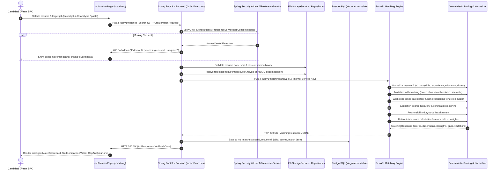

# Explainable Resume–Job Matching Engine — Architecture & Specification

## 1. Overview & Vision

The **Explainable Resume–Job Matching Engine** in JobAchiever AI provides deterministic, evidence-grounded alignment analysis comparing candidate resumes against employer job descriptions. 

Unlike conventional hiring platforms that emit opaque, hallucinated similarity numbers, the JobAchiever matching engine produces mathematically deterministic scores grounded strictly in explicit resume evidence and stated job requirements. Every score dimension is accompanied by verbatim excerpts, classification levels, identified strengths, and objective gap analysis.

### Non-Negotiable Core Principles:
1. **Zero Fabrication & Anti-Hallucination:** The matching engine never fabricates skills, qualifications, or experience. When a skill is absent from the resume, it is neutrally categorized as `"not demonstrated in this resume"`, never as an assumption about candidate incompetence.
2. **Deterministic Scoring Framework:** Dimension and overall compatibility scores are computed using fixed mathematical formulas with re-normalized denominators. LLMs are prohibited from inventing numeric scores.
3. **Explicit Multi-Tier Evidence Classification:**
   - Classifications: `MATCHED`, `PARTIALLY_MATCHED`, `NOT_FOUND`, `NEEDS_REVIEW`, `NOT_APPLICABLE`.
   - Match Types: `EXACT`, `ALIAS`, `CLOSELY_RELATED`, `SEMANTIC`, `NONE`.
4. **Mandatory AI Processing Consent:** No resume text or job description is transmitted to external AI providers without authenticated user consent (`userAiPreferenceService.hasConsent(userId)`).
5. **Decoupled Architecture:** Spring Boot 3.x owns tenancy, document ownership, authorization, and persistence (`job_matches` table). The Python FastAPI microservice is a stateless computation engine.
6. **Provider Isolation & Manual Selection:** Candidate selects Groq (primary) or Google Gemini (secondary). No automatic routing or silent fallback occurs.
7. **Strict Non-Guarantee Disclaimer:** Compatibility scores are explicitly presented as heuristic alignment estimates, not ATS scores, hiring probabilities, or guarantees of interview or employment.

---

## 2. End-to-End System Architecture



---

## 3. Deterministic Scoring Framework

Overall compatibility is computed across six core dimensions with predefined base weights:

$$\text{Overall Score} = \sum_{i} \left( \text{Score}_i \times \text{Effective Weight}_i \right)$$

### Standard Dimension Weights:
| Dimension | Base Weight | Evaluation Criteria |
| :--- | :--- | :--- |
| **Required Skills** | **35%** | Exact matches (1.0), Canonical aliases (1.0), Closely related (0.6), Not found (0.0). |
| **Work Experience** | **20%** | Non-overlapping verified tenure vs minimum required years. Tiered penalty if below threshold. |
| **Core Responsibilities** | **15%** | Verbatim token overlap and semantic context between JD deliverables and resume achievements. |
| **Education & Qualifications** | **10%** | Degree level hierarchy (PhD > Master's > Bachelor's > Associate) and field of study alignment. |
| **Preferred / Bonus Skills** | **10%** | Nice-to-have technologies, bonus frameworks, and specialized tools. |
| **Domain & Tools** | **10%** | Ancillary industry familiarity, cloud providers, and development tooling. |

### Dynamic Weight Re-normalization:
If a job description omits a specific dimension (e.g., no educational degree specified, or no preferred skills listed), the unstated dimension is assigned status `UNSTATED` with weight 0, and the remaining active dimensions have their weights re-normalized to sum to exactly 100%:

$$\text{Weight}_{\text{eff}, i} = \frac{\text{Base Weight}_i}{\sum_{k \in \text{Active}} \text{Base Weight}_k}$$

No candidate is penalized for criteria not requested by the employer.

---

## 4. Multi-Tier Skill Matching Engine

Skills are evaluated through four progressive deterministic tiers:

```
[Raw Skill Token] 
      │
      ▼
 Tier 1: Exact Match (Normalized case, trim, punctuation stripped) -> Score: 100%
      │
      ▼
 Tier 2: Canonical Alias Dictionary (e.g. "K8s" -> "Kubernetes", "Postgres" -> "PostgreSQL") -> Score: 100%
      │
      ▼
 Tier 3: Closely Related Skills Graph (e.g. "Spring Boot" <-> "Spring Framework", "FastAPI" <-> "Flask") -> Score: 60% (PARTIALLY_MATCHED)
      │
      ▼
 Tier 4: Unmatched / Missing -> Score: 0% ("Not demonstrated in this resume")
```

### Canonical Alias Dictionary Highlights:
- `JS` $\rightarrow$ `JavaScript`
- `TS` $\rightarrow$ `TypeScript`
- `K8s` $\rightarrow$ `Kubernetes`
- `Postgres` $\rightarrow$ `PostgreSQL`
- `React.js` / `ReactJS` $\rightarrow$ `React`
- `Vue.js` / `VueJS` $\rightarrow$ `Vue`
- `Node.js` / `NodeJS` $\rightarrow$ `Node`
- `AWS` $\rightarrow$ `Amazon Web Services`
- `GCP` $\rightarrow$ `Google Cloud Platform`

### Non-Overlapping Experience Calculation:
To prevent inflated tenure calculations when candidates hold concurrent roles (e.g., freelance work during employment), the experience matcher parses start and end dates (`YYYY-MM`), converts them into date intervals, and merges all overlapping periods before calculating net professional years.

---

## 5. Database Schema (Flyway Migration V18)

Migration script: `backend/src/main/resources/db/migration/V18__create_job_matches_table.sql`

```sql
CREATE TABLE job_matches (
    id UUID PRIMARY KEY DEFAULT gen_random_uuid(),
    user_id UUID NOT NULL,
    resume_id UUID NOT NULL,
    resume_version_id UUID,
    job_id UUID,
    job_analysis_id UUID,
    provider VARCHAR(32) NOT NULL,
    model VARCHAR(128),
    overall_score INT NOT NULL,
    required_skills_score INT,
    preferred_skills_score INT,
    experience_score INT,
    qualifications_score INT,
    responsibilities_score INT,
    confidence_score DOUBLE PRECISION,
    match_summary TEXT,
    match_json JSONB NOT NULL,
    created_at TIMESTAMPTZ NOT NULL DEFAULT CURRENT_TIMESTAMP,

    CONSTRAINT fk_job_matches_user FOREIGN KEY (user_id) REFERENCES users(id) ON DELETE CASCADE,
    CONSTRAINT fk_job_matches_resume FOREIGN KEY (resume_id) REFERENCES resume_documents(id) ON DELETE CASCADE,
    CONSTRAINT fk_job_matches_resume_version FOREIGN KEY (resume_version_id) REFERENCES resume_versions(id) ON DELETE SET NULL,
    CONSTRAINT fk_job_matches_job FOREIGN KEY (job_id) REFERENCES jobs(id) ON DELETE SET NULL,
    CONSTRAINT fk_job_matches_job_analysis FOREIGN KEY (job_analysis_id) REFERENCES job_analyses(id) ON DELETE SET NULL
);

CREATE INDEX idx_job_matches_user_id ON job_matches(user_id);
CREATE INDEX idx_job_matches_resume_id ON job_matches(resume_id);
CREATE INDEX idx_job_matches_job_id ON job_matches(job_id);
CREATE INDEX idx_job_matches_created_at ON job_matches(created_at DESC);
```

---

## 6. API Endpoints

### Spring Boot Primary Backend (`/api/v1/matches`):
| Method | Endpoint | Description | Auth Required |
| :--- | :--- | :--- | :--- |
| `POST` | `/api/v1/matches` | Executes resume-job match and returns `JobMatchDto`. | Bearer JWT + Consent |
| `GET` | `/api/v1/matches` | Retrieves match history summaries for the authenticated candidate. | Bearer JWT |
| `GET` | `/api/v1/matches/{matchId}` | Retrieves full report details by match UUID. | Bearer JWT (Owner only) |
| `DELETE` | `/api/v1/matches/{matchId}` | Deletes a match report record. | Bearer JWT (Owner only) |
| `GET` | `/api/v1/matches/job/{jobId}` | Retrieves match history for a specific job. | Bearer JWT |
| `GET` | `/api/v1/matches/resume/{resumeId}`| Retrieves match history for a specific resume. | Bearer JWT |

### FastAPI Internal AI Microservice (`/api/v1/matching`):
| Method | Endpoint | Description | Auth Required |
| :--- | :--- | :--- | :--- |
| `POST` | `/api/v1/matching/analyze` | Dispatches deterministic multi-dimensional matching. | `X-Internal-Service-Key` + Consent |
| `POST` | `/api/v1/matching/match` | Alias endpoint for `/analyze`. | `X-Internal-Service-Key` + Consent |

---

## 7. Frontend Integration

1. **Route:** `/matching` (with legacy aliases `/job-match` and `/job-matcher`) in `AppRoutes.jsx`.
2. **Components:**
   - `IntelligentMatchScoreCard`: Displays 0–100 compatibility gauge, rating badge, 6 dimension breakdown cards, and mandatory transparency disclaimer.
   - `SkillComparisonMatrix`: Displays requirement vs profile evidence with status badges (`Strong Evidence`, `Partial Evidence`, `No Recorded Evidence`) and expandable drawers showing verbatim quotes.
   - `GapAnalysisPanel`: Prioritizes missing skills and provides constructive recommendations to document existing experience honestly.
   - `SavedJobAnalysesModal`: Lists historical matches with reload and delete capabilities.
3. **Client Service:** `frontend/src/services/jobMatchingService.js` coordinates with `/api/v1/matches` and normalizes the payload via `normalizeBackendMatch(dto)`.
