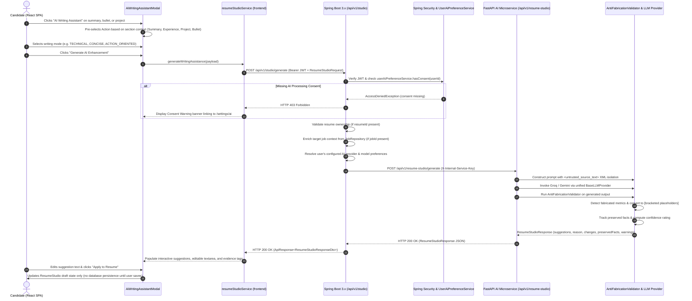
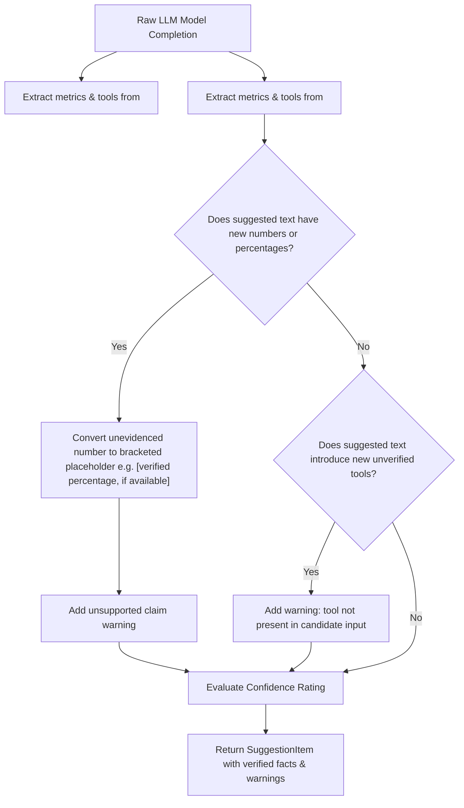

# AI-Powered Resume Studio Writing Assistant — Architecture & Specification

## 1. Overview & Product Vision

The **Resume Studio Writing Assistant** transforms the JobAchiever AI resume creation environment from a manual document editor into an intelligent, evidence-grounded career writing workbench.

Candidates can draft, refine, and polish individual resume bullets, executive summaries, project deliverables, and work experience entries. Every suggestion adheres strictly to JobAchiever AI's core non-negotiables:

### Core Architectural Principles:
1. **Zero Fabrication & Anti-Hallucination:**
   - The writing assistant NEVER invents technical proficiencies, tools, employer names, dates, metrics, percentages, dollar amounts, or achievements not present in candidate input or verified profile data.
   - Any suggested metric without direct numeric backing in source input is strictly enclosed in safe bracketed placeholders (e.g. `[verified percentage, if available]`, `[verified scale/throughput, if available]`).
2. **Deterministic Anti-Fabrication Engine (`AntiFabricationValidator`):**
   - Independent validation layer operating after LLM output generation.
   - Extracts numbers, percentages, currencies, and technical tools.
   - Automatically sanitizes unevidenced raw numbers into bracketed verification placeholders.
   - Flags unsupported claims with explicit candidate warnings and confidence ratings (`HIGH`, `MEDIUM`, `LOW`).
3. **Draft-Only Editor Updates:**
   - AI suggestions NEVER overwrite saved resumes or database records automatically.
   - Suggestions apply solely to the editor's live draft state (`ResumeStudioContext`) and require explicit user review and confirmation.
4. **Mandatory User Consent:**
   - External AI processing is strictly gated by `userAiPreferenceService.hasConsent(userId)`.
   - Missing consent triggers HTTP 403 Forbidden with actionable UI guidance linking to `/settings/ai`.
5. **Decoupled Two-Tier Architecture:**
   - **Spring Boot 3.x Backend:** Owns authentication, user tenancy, resume document ownership, preferences, and service-to-service security.
   - **FastAPI AI Microservice:** Stateless text-processing and validation engine communicating with Groq (Primary) and Gemini (Secondary).
6. **No Silent Provider Fallback:**
   - Users manually select their preferred AI provider in Settings. The system never falls back or silently switches between providers.

---

## 2. End-to-End System Architecture



---

## 3. Supported Enhancement Actions & Writing Modes

### Enhancement Actions (`StudioAction`):
| Action | Description | Context Application |
| :--- | :--- | :--- |
| `IMPROVE_BULLET` | Replaces weak or passive verbs with active technical leadership verbs. | Experience / Project bullets |
| `IMPROVE_SUMMARY` | Crafts high-impact executive summaries grounded in verified skills. | Professional Summary |
| `IMPROVE_PROJECT` | Structures project entries around problem, architecture, stack, and outcome. | Projects & Portfolio |
| `IMPROVE_EXPERIENCE` | Refines role scope, deliverables, and operational accountability. | Work Experience entries |
| `FIX_GRAMMAR` | Fixes syntax, punctuation, and sentence rhythm without changing facts. | Any section text |
| `MAKE_CONCISE` | Cuts fluff words (`in order to`, `various`) to maximize information density. | Long bullets or narratives |
| `TAILOR_TO_JOB` | Aligns phrasing with target JD keywords while prohibiting skill fabrication. | Any section targeted to role |
| `GENERATE_ALTERNATIVES` | Emits 3 distinct phrasings with varying tone and emphasis. | Any section text |

### Stylistic Writing Modes (`WritingMode`):
| Mode | Focus & Characteristics |
| :--- | :--- |
| `PROFESSIONAL` | Balanced corporate phrasing suitable across all industries. |
| `CONCISE` | High-density phrasing eliminating all non-essential filler. |
| `TECHNICAL` | Architecture, systems, scalability, and stack-heavy phrasing. |
| `ACHIEVEMENT_FOCUSED` | Emphasizes deliverables, milestones, and operational outcomes. |
| `ACTION_ORIENTED` | Dynamic, decisive opening verbs demonstrating initiative. |
| `ATS_FRIENDLY` | Aligned with standard parser taxonomies and keyword recognition. |

---

## 4. Anti-Fabrication Engine & Validation Rules

The `AntiFabricationValidator` enforces strict verification checks before returning rewrites:



### Safe Bracketed Placeholder Replacements:
- Unevidenced percentages (e.g. `improved by 45%` without `%` in input) -> `improved by [verified percentage, if available]`
- Unevidenced scale / counts (e.g. `served 500k requests` without counts in input) -> `served [verified scale/throughput, if available]`
- Unevidenced dollar amounts (e.g. `$2M cost savings`) -> `[verified cost reduction, if available]`

---

## 5. REST API Specifications

### Backend Endpoint: `POST /api/v1/studio/generate` (Alias: `/api/v1/studio/rewrite`)

#### Request Headers:
```http
Authorization: Bearer <JWT_ACCESS_TOKEN>
Content-Type: application/json
```

#### Request Payload (`ResumeStudioRequest`):
```json
{
  "action": "IMPROVE_BULLET",
  "source_text": "Worked on backend microservices with Java and PostgreSQL.",
  "writing_mode": "PROFESSIONAL",
  "context": {
    "section": "experience",
    "role": "Senior Backend Engineer",
    "company": "Apex Systems"
  },
  "num_alternatives": 1
}
```

#### Response Payload (`ApiResponse<ResumeStudioResponseDto>`):
```json
{
  "success": true,
  "message": "Resume studio suggestions generated successfully",
  "data": {
    "action": "IMPROVE_BULLET",
    "writing_mode": "PROFESSIONAL",
    "provider": "GROQ",
    "model": "llama-3.3-70b-versatile",
    "suggestions": [
      {
        "id": "sug-0",
        "original_text": "Worked on backend microservices with Java and PostgreSQL.",
        "suggested_text": "Architected resilient distributed backend microservices utilizing Java and PostgreSQL.",
        "reason": "Replaced weak passive verb 'Worked on' with technical leadership descriptor.",
        "changes": [
          "Replaced 'Worked on' with 'Architected resilient distributed'",
          "Enhanced architectural clarity"
        ],
        "preserved_facts": ["backend microservices", "Java", "PostgreSQL"],
        "unsupported_claims": [],
        "warnings": [],
        "confidence": "HIGH",
        "writing_mode": "PROFESSIONAL"
      }
    ],
    "disclaimer": "JobAchiever AI enforces strict zero-fabrication. Verify that all statements accurately represent your achievements."
  }
}
```

---

## 6. Verification & Test Coverage Summary

| Test Suite | Test Count | Status | Description |
| :--- | :---: | :---: | :--- |
| **FastAPI Microservice** (`pytest`) | 147 | **PASS** | Schema validation, prompt XML isolation, anti-fabrication validator, fallback generation. |
| **Spring Boot Backend** (`mvnw test`) | 274 | **PASS** | Controller integration, Bearer security, consent checks, tenancy isolation, AIServiceClient mocks. |
| **Frontend SPA** (`vitest`) | 114 | **PASS** | `AiWritingAssistantModal` lifecycle, action/mode switching, fallback rendering, draft state updates. |
| **Frontend Code Quality** (`eslint`) | 0 warnings | **PASS** | Strict clean build with zero lint errors or warnings. |
| **Production Build** (`vite build`) | 1.65 kB html / 838 kB JS | **PASS** | Minified production build verified without chunking errors. |
