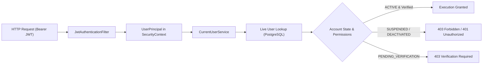

# Centralized Authorization, User Ownership and Spring Security Architecture

## 1. Overview & Security Posture

JobAchiever AI enforces a **zero-trust, server-authoritative authorization model**. Every incoming request to private resources is validated against the authenticated user context derived exclusively from cryptographically signed, server-verified JWT bearer tokens.

Client-supplied user IDs, query parameters, and JSON body references are **never trusted** as proof of ownership or authorization.

---

## 2. Authenticated User Context (`CurrentUserService`)

The `CurrentUserService` interface (`ai.jobachiever.common.security.CurrentUserService`) serves as the single source of truth for resolving the calling user's identity and privileges across the application.



### Methods Provided
| Method | Return Type | Description |
| :--- | :--- | :--- |
| `getAuthenticatedUserId()` | `UUID` | Returns the authenticated user's UUID. Throws `InvalidTokenException` if unauthenticated. |
| `findAuthenticatedUserId()` | `Optional<UUID>` | Safely checks for an authenticated user ID without throwing. |
| `getCurrentUser()` | `User` | Loads the live user entity from PostgreSQL, avoiding stale JWT claims. |
| `getAccountStatus()` | `AccountStatus` | Retrieves live account status (`ACTIVE`, `PENDING_VERIFICATION`, `SUSPENDED`, `DEACTIVATED`). |
| `isEmailVerified()` | `boolean` | Checks whether the user has verified their email address. |
| `getRole()` | `Role` | Returns the assigned platform role (`USER` or `ADMIN`). |
| `hasRole(String role)` | `boolean` | Evaluates if the caller holds the given role. |
| `isAdmin()` | `boolean` | Helper checking for `ROLE_ADMIN`. |
| `requireActiveUser()` | `User` | Enforces that the account is authenticated, active, and verified. |
| `requireVerifiedUser()` | `User` | Enforces that email verification has completed before permitting access. |

---

## 3. Resource Ownership Architecture (`ResourceOwnershipService`)

Private domain resources (career profiles, career tracks, resumes, applications, activities) must never be accessible across user boundaries.

### Non-Enumeration Standard (404 Not Found)
When a user attempts to read, modify, or delete a private resource that belongs to another user, the system returns **`HTTP 404 Not Found`** rather than `403 Forbidden`. This strictly prevents attackers from enumerating valid resource IDs.

### Safe Ownership Query Patterns
All repositories providing access to private data enforce tenant isolation at the query level using compound identifiers:

```java
// Safe Repository Query Patterns:
Optional<CareerProfile> findByIdAndUserId(UUID id, UUID userId);
Optional<CareerTrack> findByIdAndUserId(UUID id, UUID userId);
Optional<ResumeDocument> findByIdAndUserId(UUID id, UUID userId);
Optional<ResumeVersion> findByIdAndDocumentUserId(UUID id, UUID userId);
Optional<JobApplication> findByIdAndUserId(UUID id, UUID userId);
Optional<ApplicationActivity> findByIdAndApplicationUserId(UUID id, UUID userId);
```

### Cross-Resource Reference Prevention
When creating or updating entities with child relationships (e.g. attaching a `ResumeVersion` to a `JobApplication`), the service layer validates that the referenced version belongs to the authenticated user:
```java
// Validates that User A cannot link User B's resume version to their application
ownershipService.validateResumeVersionForApplication(resumeVersionId, authenticatedUserId);
```

---

## 4. Role and Authority Model

JobAchiever AI employs a lean, non-bloated authority model:

| Role | Granted Authorities | Permitted Operations |
| :--- | :--- | :--- |
| `USER` | `ROLE_USER`, `AUTHORITY_VERIFIED_EMAIL` (when verified) | Manage personal career profile, career tracks, resumes, job applications, interview practice. |
| `ADMIN` | `ROLE_ADMIN`, `ROLE_USER`, `AUTHORITY_VERIFIED_EMAIL` | All `USER` capabilities plus platform oversight, account suspension/activation, role assignment, and audit log inspection (`/api/v1/admin/**`). |

### Registration Guardrail
Public registration endpoints (`POST /api/v1/auth/register`) strictly default the user's role to `Role.USER`. Any client attempt to inject an `ADMIN` role is stripped and ignored. Role elevation is strictly restricted to administrative APIs protected by `hasRole('ADMIN')`.

---

## 5. Account State Enforcement

| Account Status | Can Authenticate? | Can Access Public Routes? | Can Access Private Verified Resources? |
| :--- | :---: | :---: | :---: |
| `ACTIVE` | Yes | Yes | Yes |
| `PENDING_VERIFICATION` | Yes | Yes (OTP verify/resend) | No (`HTTP 403 Account verification required`) |
| `SUSPENDED` | No (`HTTP 401/403`) | Yes (Health) | No |
| `DEACTIVATED` | No (`HTTP 401/403`) | Yes (Health) | No |

Status changes take effect immediately on subsequent requests because `JwtAuthenticationFilter` validates live user state via `CustomUserDetailsService.loadUserById(userId)`.

---

## 6. Spring Security Hardening & Public Allowlist

The `SecurityFilterChain` in `SecurityConfig.java` enforces:
1. **Stateless Sessions:** `SessionCreationPolicy.STATELESS` — zero HTTP session cookies.
2. **Explicit Public Allowlist:**
   - Registration: `POST /api/v1/auth/register`
   - Login: `POST /api/v1/auth/login`
   - Email OTP: `POST /api/v1/auth/verify-email`, `POST /api/v1/auth/verify-otp`
   - Resend OTP: `POST /api/v1/auth/resend-verification`, `POST /api/v1/auth/resend-otp`
   - Password Recovery: `POST /api/v1/auth/forgot-password`, `POST /api/v1/auth/reset-password`
   - Health Checks: `GET /api/v1/health`, `GET /actuator/health`, `GET /actuator/info`
   - CORS Pre-flight: `OPTIONS /**`
3. **Explicit Admin Route Protection:** `/api/v1/admin/**` restricted to `hasRole('ADMIN')`.
4. **Default Deny:** All other endpoints require an authenticated bearer JWT (`anyRequest().authenticated()`).
5. **Security Response Headers:**
   - Content Security Policy: `default-src 'self'; frame-ancestors 'none';`
   - Frame Options: `DENY` (Clickjacking protection)
   - HTTP Strict Transport Security: `max-age=31536000; includeSubDomains`
   - X-Content-Type-Options: `nosniff`

---

## 7. Security Audit Logging (`security_audit_logs`)

All security-critical actions are recorded transactionally in the `security_audit_logs` table (`V11__add_user_roles_and_security_audit.sql`):

### Tracked Event Types
- `ACCOUNT_REGISTERED`
- `LOGIN_SUCCESS`
- `LOGIN_FAILURE`
- `PASSWORD_RESET_REQUESTED`
- `PASSWORD_RESET_COMPLETED`
- `EMAIL_VERIFIED`
- `ACCOUNT_SUSPENDED`
- `ACCOUNT_DEACTIVATED`
- `ROLE_CHANGED`
- `TOKEN_REVOKED`
- `ACCESS_DENIED`

### Audit Guarantees
- Passwords, OTPs, JWTs, reset tokens, and secrets are **strictly omitted** from audit records.
- Records capture client IP (`X-Forwarded-For` aware), User-Agent, UTC timestamp, event type, and user ID.
